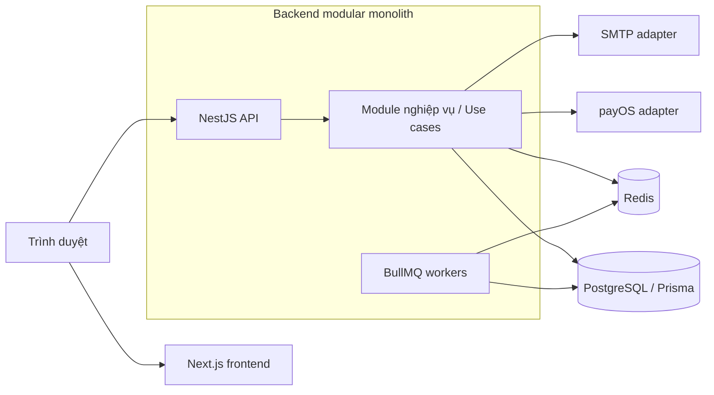

# Pickleball Booking

Hệ thống đặt sân Pickleball, kết nối trải nghiệm tìm sân và đặt chỗ với quy trình thanh toán, quản lý booking và check-in. Hệ thống phục vụ hội viên, khách vãng lai và nhân viên vận hành.

Frontend sử dụng **Next.js**, backend tổ chức theo **NestJS modular monolith**, với **PostgreSQL** bảo vệ tính nhất quán dữ liệu và **Redis/BullMQ** hỗ trợ phiên cùng tác vụ nền.

## Chức năng chính

- **Tìm và đặt sân:** xem danh mục, giá và lịch trống; giữ chỗ có thời hạn, theo dõi và hủy booking.
- **Tài khoản và khách vãng lai:** đăng nhập, xác minh email OTP, khôi phục tài khoản và quản lý booking theo quyền.
- **Thanh toán:** đặt cọc, tiếp nhận webhook payOS, ghi nhận giao dịch, đối soát và xử lý yêu cầu hoàn tiền.
- **Vận hành lượt chơi:** quản lý booking, cấp và xác minh token check-in QR hoặc check-in thủ công theo điều kiện phía server.

Chi tiết luồng và chính sách tại [Quy trình nghiệp vụ](docs/WORKFLOWS.md).

## Kiến trúc hệ thống

Backend chia theo miền **Auth/Users, Courts, Bookings, Payments và Check-in**. Controller tiếp nhận HTTP, use case điều phối nghiệp vụ, còn port và adapter phân định ranh giới truy cập dữ liệu, hàng đợi và dịch vụ ngoài. Cách tổ chức này giữ trách nhiệm từng miền rõ ràng trong một đơn vị triển khai backend.

Frontend tổ chức theo feature, tách giao diện, hook, API và model. PostgreSQL là nguồn dữ liệu chính; Redis hỗ trợ phiên, CSRF, rate limit và hàng đợi. API và worker được lắp ghép trong cùng backend; lịch sân hiện cập nhật qua HTTP polling.

Đọc sâu tại [Kiến trúc hệ thống](docs/ARCHITECTURE.md), [Backend](docs/BACKEND-ARCHITECTURE.md) và [Frontend](docs/FRONTEND-ARCHITECTURE.md).

## Điểm nổi bật về kỹ thuật

- **Bảo vệ lịch sân tại database:** PostgreSQL exclusion constraint ngăn khoảng chiếm sân chồng lấn, bao gồm thời gian vệ sinh. Transaction giữ booking, snapshot giá, occupancy và lịch sử nhất quán.
- **Xử lý yêu cầu lặp và thanh toán bất đồng bộ:** idempotency, webhook inbox và receipt identity hỗ trợ chống ghi nhận trùng; coordinator điều phối xác nhận booking, outbox lưu sự kiện để xử lý tiếp.
- **Server kiểm soát nghiệp vụ:** giá, thời hạn giữ chỗ, số tiền đã xác minh và trạng thái booking được quyết định phía backend. UI cập nhật theo kết quả server.
- **Phân quyền theo ngữ cảnh:** phiên người dùng, CSRF và token giới hạn theo booking bảo vệ các luồng hội viên, khách vãng lai và nhân viên; check-in kiểm tra cả điều kiện tiền và thời gian.
- **Kiểm thử theo ranh giới:** unit, HTTP contract, integration với storage riêng và frontend rendering regression được phân nhóm để kiểm tra từng tầng.

Các invariant dữ liệu, cơ chế bảo mật và cách kiểm chứng được mô tả tại [Database](docs/DATABASE.md), [Security](docs/SECURITY.md) và [Pipelines](docs/PIPELINES.md).

## Tech stack

| Thành phần          | Công nghệ                                              |
| ------------------- | ------------------------------------------------------ |
| Frontend            | Next.js App Router, React, TypeScript, CSS/CSS Modules |
| Backend             | NestJS, Node.js, TypeScript                            |
| Dữ liệu             | PostgreSQL, Prisma                                     |
| Phiên và tác vụ nền | Redis, BullMQ                                          |
| Tích hợp            | payOS, SMTP; Mailpit cho email local                   |
| Kiểm thử            | Jest, ts-jest, JSDOM                                   |
| Công cụ phát triển  | Docker Compose, GitHub Actions, Oxlint, Prettier       |

Phiên bản và vai trò từng công nghệ tại [Tech stack](docs/TECH-STACK.md).

## Trạng thái phát triển

Dự án đang phát triển. Dashboard còn dữ liệu demo; quản trị sân, bảng giá và lịch bảo trì chưa đầy đủ. Delivery email booking và realtime còn phần chưa hoàn thiện. Tích hợp thanh toán và điều kiện vận hành production cần được nghiệm thu riêng.

Phạm vi hiện tại tại [Project](docs/PROJECT.md); điều kiện phát hành tại [Release requirements](docs/RELEASE-REQUIREMENTS.md).

## Tài liệu chi tiết

| Nội dung              | Tài liệu                                                                 |
| --------------------- | ------------------------------------------------------------------------ |
| Cài đặt và chạy local | [Getting started](docs/GETTING-STARTED.md)                               |
| Cấu hình môi trường   | [Configuration](docs/CONFIGURATION.md)                                   |
| HTTP API              | [API reference](docs/API.md)                                             |
| Thiết kế dữ liệu      | [Database](docs/DATABASE.md), [Data dictionary](docs/DATABASE-DESIGN.md) |
| Vận hành và kiểm thử  | [Operations](docs/OPERATIONS.md), [Pipelines](docs/PIPELINES.md)         |
| Đóng góp              | [Contributing](CONTRIBUTING.md)                                          |
| Toàn bộ tài liệu      | [Documentation index](docs/README.md)                                    |

## Giấy phép

Chưa có giấy phép được công bố.
