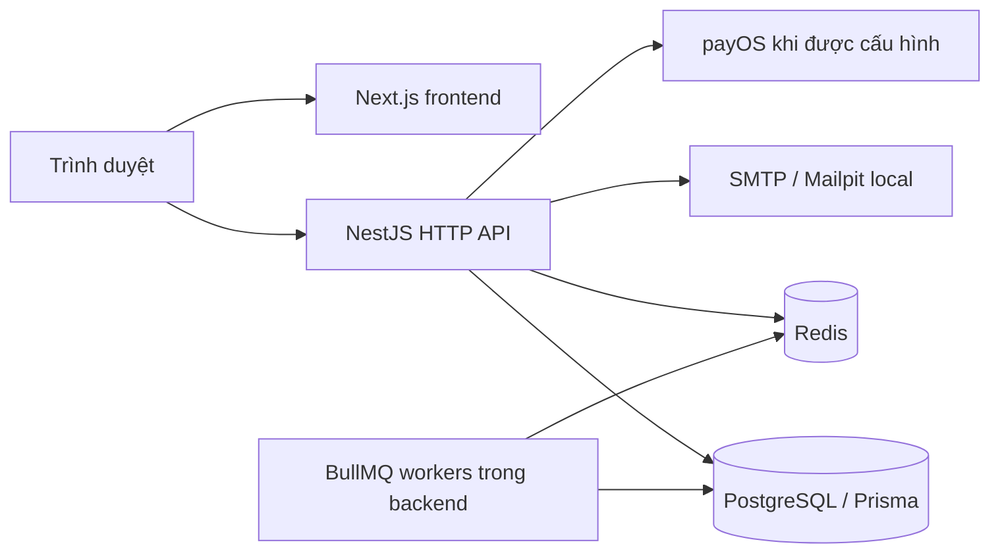

# Pickleball Booking

Ứng dụng đặt sân Pickleball với danh mục sân, lịch trống, giữ chỗ, đặt cọc và quản lý lượt chơi. Frontend dùng Next.js; API NestJS là modular monolith, với PostgreSQL/Prisma bảo vệ lịch sân và Redis/BullMQ xử lý phiên cùng tác vụ nền.

Dự án đang phát triển. Các luồng thanh toán, hoàn tiền và check-in có implementation trong repository; source hiện có chưa đồng nghĩa đã nghiệm thu ngân hàng hoặc vận hành production.

## Mục lục

- [Chức năng](#chức-năng)
- [Bắt đầu](#bắt-đầu)
- [Kiến trúc](#kiến-trúc)
- [Lệnh thường dùng](#lệnh-thường-dùng)
- [Tài liệu](#tài-liệu)
- [Đóng góp và bảo mật](#đóng-góp-và-bảo-mật)
- [Giấy phép](#giấy-phép)

## Chức năng

| Khu vực          | Phạm vi hiện có trong source                                             |
| ---------------- | ------------------------------------------------------------------------ |
| Tài khoản        | Đăng ký, đăng nhập, email OTP, recovery, hồ sơ và thu hồi phiên          |
| Danh mục sân     | Sân hoạt động, giá theo phút và lịch chiếm sân                           |
| Đặt sân          | Giữ chỗ HOLDING 5 phút, idempotency, snapshot giá, expiry và hủy hold    |
| Khách vãng lai   | Email OTP, tạo hold và token quản lý giới hạn theo booking               |
| Thanh toán       | Payment request, adapter payOS, webhook inbox, receipt và đối soát       |
| Hủy và hoàn tiền | Báo phí, consent, yêu cầu hoàn và thao tác của nhân viên                 |
| Check-in         | Token, xác minh QR hoặc thủ công; kiểm tra tiền còn thiếu ở server       |
| Hỗ trợ           | Trợ lý theo knowledge/provider, chính sách và tiếp nhận yêu cầu riêng tư |

Booking mới đặt cọc **30%** cho hội viên và khách vãng lai. Vệ sinh tối thiểu **15 phút** không tính tiền. Xem [quy trình nghiệp vụ](docs/WORKFLOWS.md).

Dashboard còn dữ liệu DEMO; quản trị sân/bảng giá/block bảo trì chưa đầy đủ; dịch vụ bổ sung và coupon chưa hoàn thiện. Availability dùng HTTP polling; Socket.IO chưa nối vào booking. Email booking qua outbox và hoàn tiền tự động cần provider, hạ tầng và kiểm chứng riêng. Xem [phạm vi và khoảng trống](docs/PROJECT.md).

## Bắt đầu

Cần Node.js theo [.nvmrc](.nvmrc), npm, PostgreSQL, Redis và Docker Compose v2 nếu dùng hạ tầng local. Dependency dùng chung [package.json](package.json) và [lockfile](package-lock.json) tại root.

```powershell
git clone https://github.com/QuanVu512/BookingManagement.git
cd BookingManagement
npm ci
```

Làm theo [khởi động local](docs/GETTING-STARTED.md) để tạo env, chạy hạ tầng và apply migration vào DB development mới. Sau đó mở hai terminal riêng:

```powershell
# Terminal API, sau cấu hình và migration
npm run start:dev
```

```powershell
# Terminal frontend
npm run web:dev
```

| Dịch vụ                   | Địa chỉ theo cấu hình local        |
| ------------------------- | ---------------------------------- |
| Website                   | <http://localhost:4001>            |
| API danh mục sân          | <http://localhost:4000/api/courts> |
| Swagger, ngoài production | <http://localhost:4000/api/docs>   |
| Mailpit local             | <http://127.0.0.1:8025>            |

API cần `PORT=4000`; thiếu biến này, bootstrap mặc định dùng `3000`. Website trả HTML thành công chưa chứng minh API hoặc DB sẵn sàng.

## Kiến trúc



PostgreSQL transaction và exclusion constraint bảo vệ việc đặt trùng sân, gồm buffer vệ sinh. Server quyết định giá, thời gian, quyền và trạng thái thanh toán. Xem [kiến trúc hệ thống](docs/ARCHITECTURE.md).

```text
backend/src/modules/       Module nghiệp vụ và HTTP API
backend/prisma/            Schema, migration và seed
frontend/app/              Next.js routes
frontend/features/         Component, hook, API và model theo feature
infra/                     Docker Compose cho dịch vụ local
tests/load/                Kịch bản smoke/load
docs/                      Hướng dẫn và tham chiếu hệ thống
```

## Lệnh thường dùng

Chạy từ root; đọc [pipeline](docs/PIPELINES.md) để chọn môi trường và hiểu side effect.

| Lệnh                               | Mục đích                                          |
| ---------------------------------- | ------------------------------------------------- |
| `npm run lint`                     | Type-aware lint backend/frontend                  |
| `npm test`                         | Backend unit và frontend Jest/JSDOM               |
| `npm run test:auth:contract`       | HTTP auth contract và frontend validation/network |
| `npm run test:booking:ui`          | Rendering regression booking trong JSDOM          |
| `npm run test:booking:integration` | Booking với DB/Redis test riêng                   |
| `npm run build`                    | Sinh Prisma client và build API, không migrate    |
| `npm run build:web`                | Build frontend; production cần API origin HTTPS   |
| `npm run prisma:migrate:status`    | Trạng thái migration DB đã chọn                   |

`test:e2e` có pre-hook khởi động lại container test và apply migration. Không dùng DB ứng dụng làm DB test. Số lượng test hoặc CI result cũ không chứng minh revision hiện tại.

## Tài liệu

| Nhu cầu              | Tài liệu                                                                           |
| -------------------- | ---------------------------------------------------------------------------------- |
| Khởi động lần đầu    | [Getting started](docs/GETTING-STARTED.md)                                         |
| Biến môi trường      | [Configuration](docs/CONFIGURATION.md)                                             |
| HTTP API và auth     | [API reference](docs/API.md)                                                       |
| Nghiệp vụ            | [Workflows](docs/WORKFLOWS.md)                                                     |
| Kiến trúc thành phần | [Backend](docs/BACKEND-ARCHITECTURE.md), [Frontend](docs/FRONTEND-ARCHITECTURE.md) |
| Dữ liệu              | [Database](docs/DATABASE.md), [data dictionary](docs/DATABASE-DESIGN.md)           |
| Vận hành             | [Operations](docs/OPERATIONS.md), [CI troubleshooting](docs/CI-TROUBLESHOOTING.md) |
| Toàn bộ danh mục     | [Documentation index](docs/README.md)                                              |

## Đóng góp và bảo mật

Đọc [CONTRIBUTING.md](CONTRIBUTING.md) trước khi gửi thay đổi. Cập nhật tài liệu cùng hành vi và ghi rõ kiểm tra thực sự đã chạy.

Session, CSRF và phân quyền xem [SECURITY.md](docs/SECURITY.md). Không đưa mật khẩu, cookie, guest token, URL DB thật hoặc dữ liệu khách hàng vào issue, log hay screenshot. Báo lỗ hổng qua kênh riêng của chủ repository.

## Giấy phép

[package.json](package.json) khai báo `private: true` và `license: UNLICENSED`. Repository chưa cấp giấy phép mã nguồn mở; cần được chủ sở hữu cho phép trước khi phân phối hoặc sử dụng lại ngoài phạm vi được cấp quyền.
