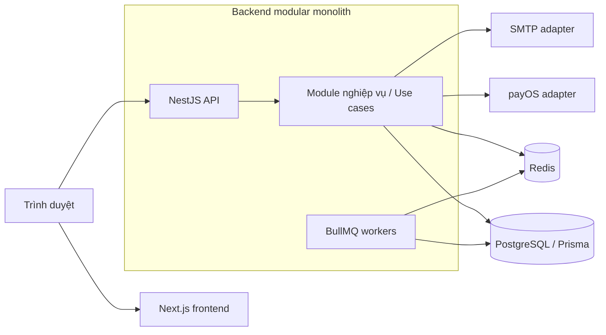

# Pickleball Booking

Hệ thống đặt sân Pickleball, kết nối trải nghiệm tìm sân và đặt chỗ với quy trình thanh toán, quản lý booking và check-in. Hệ thống phục vụ hội viên, khách vãng lai và nhân viên vận hành.

Frontend sử dụng **Next.js App Router** (CSS/CSS Modules), backend tổ chức theo **NestJS modular monolith**, với **PostgreSQL** bảo vệ tính nhất quán dữ liệu và **Redis/BullMQ** hỗ trợ phiên cùng tác vụ nền.

## Chức năng chính

- **Tìm và đặt sân:** xem danh mục, giá và lịch trống theo khoảng thời gian; giữ chỗ 5 phút với mức cọc 30% thống nhất cho cả hội viên và khách vãng lai, theo dõi và hủy booking.
- **Tài khoản và khách vãng lai:** đăng nhập, xác minh email OTP, khôi phục tài khoản; khách vãng lai đặt sân qua xác thực OTP email một lần (`otpProof`), định danh phiên (`checkoutIntentId`, `recoverySecret`) và tra cứu/khôi phục đơn qua liên kết bảo mật.
- **Thanh toán:** tạo yêu cầu đặt cọc bền vững (`PaymentRequest`), tiếp nhận webhook payOS hoặc mô phỏng thanh toán local, ghi nhận giao dịch, đối soát và xử lý yêu cầu hoàn tiền.
- **Vận hành lượt chơi:** quản lý booking, cấp và xác minh token check-in QR hoặc check-in thủ công, thu phần tiền còn lại tại quầy và xử lý hủy muộn theo điều kiện phía máy chủ.

Chi tiết luồng và chính sách tại [Quy trình nghiệp vụ](docs/WORKFLOWS.md).

## Kiến trúc hệ thống



Backend chia theo miền **Auth/Users, Courts, Bookings, Payments, Check-in, AI Assistant, Legal/Privacy và Support**. Controller tiếp nhận HTTP, use case điều phối nghiệp vụ, còn port và adapter phân định ranh giới truy cập dữ liệu, hàng đợi và dịch vụ ngoài.

Frontend tổ chức theo feature (`courts`, `booking`, `payment`, `account`, `ai-assistant`, `cookie-consent`, `legal`, `privacy`, `support`), tách giao diện, hook, API và model. PostgreSQL là nguồn dữ liệu chính (session luôn ghim múi giờ UTC ở tầng kết nối); Redis hỗ trợ phiên, CSRF, rate limit, khóa slot bổ trợ và hàng đợi BullMQ. Lịch sân cập nhật qua HTTP polling.

Đọc sâu tại [Kiến trúc hệ thống](docs/ARCHITECTURE.md), [Backend](docs/BACKEND-ARCHITECTURE.md) và [Frontend](docs/FRONTEND-ARCHITECTURE.md).

## Điểm nổi bật về kỹ thuật

- **Bảo vệ lịch sân tại database:** PostgreSQL exclusion constraint ngăn khoảng chiếm sân chồng lấn (`court_occupancies`), bao gồm thời gian vệ sinh (`cleanup_minutes >= 0`). Transaction giữ booking, snapshot giá, occupancy, lịch sử và yêu cầu thanh toán ban đầu nhất quán.
- **Xử lý yêu cầu lặp và thanh toán bất đồng bộ:** idempotency, generación fencing với PostgreSQL advisory lock cho khách vãng lai, webhook inbox và receipt identity hỗ trợ chống ghi nhận trùng; coordinator điều phối xác nhận booking, outbox lưu sự kiện để xử lý tiếp.
- **Máy chủ kiểm soát nghiệp vụ:** giá, thời hạn giữ chỗ, số tiền đã xác minh, đồng hồ hệ thống và trạng thái booking được quyết định phía backend. Giao diện cập nhật theo kết quả máy chủ trả về, không tự suy diễn trạng thái thanh toán từ bộ đếm giờ phía trình duyệt.
- **Phân quyền theo ngữ cảnh:** phiên người dùng (cookie HttpOnly + CSRF), token quản lý đơn (`X-Booking-Access-Token`) và token khôi phục lượt đặt (`X-Booking-Checkout-Token`) bảo vệ từng luồng hội viên, khách vãng lai và nhân viên; check-in kiểm tra cả điều kiện tiền và thời gian.
- **Kiểm thử theo ranh giới:** unit, HTTP contract, integration với storage riêng và frontend rendering regression được phân nhóm để kiểm tra từng tầng.

Các ràng buộc dữ liệu, cơ chế bảo mật và cách kiểm chứng được mô tả tại [Database](docs/DATABASE.md), [Security](docs/SECURITY.md) và [Pipelines](docs/PIPELINES.md).

## Tech stack

| Thành phần          | Công nghệ                                                          |
| ------------------- | ------------------------------------------------------------------ |
| Frontend            | Next.js App Router (`~16.4.2`), React (`~19.3.0`), CSS/CSS Modules |
| Backend             | NestJS (`~12.1.2`), Node.js (`>=24.15.0 <25`), TypeScript (`~6.0`) |
| Dữ liệu             | PostgreSQL 16, Prisma (`~7.10.0`, `@prisma/adapter-pg`)            |
| Phiên và tác vụ nền | Redis 7, BullMQ (`~6.3.11`)                                        |
| Tích hợp            | payOS (`@payos/node`), Nodemailer SMTP; Mailpit cho email local    |
| Kiểm thử            | Jest (`~30.5.2`), ts-jest, JSDOM                                   |
| Công cụ phát triển  | Docker Compose, GitHub Actions, Oxlint, Prettier                   |

Phiên bản và vai trò từng công nghệ tại [Tech stack](docs/TECH-STACK.md).

## Khởi động nhanh (Local Development)

### 1. Yêu cầu môi trường

- **Node.js**: `>=24.15.0 <25` (khuyến nghị `24.21.0` theo `.nvmrc`).
- **Docker Compose v2**: chạy PostgreSQL (`5433`), Redis (`6380`) và Mailpit (`1025`/`8025`).

```powershell
npm ci
```

### 2. Biến môi trường

Tạo 3 tệp cấu hình local (không commit vào Git) theo mẫu chi tiết tại [Configuration](docs/CONFIGURATION.md):

- `infra/.env`: thông tin khởi tạo container (`POSTGRES_USER`, `POSTGRES_PASSWORD`, `POSTGRES_DB`, `POSTGRES_PORT=5433`).
- `backend/.env`: cấu hình API (`PORT=4000`, `WEB_ORIGIN=http://localhost:4001`, `DATABASE_URL`, `REDIS_URL`, `REDIS_HOST`, `REDIS_PORT`, `JWT_SECRET` tối thiểu 32 ký tự ngẫu nhiên, cấu hình SMTP Mailpit `127.0.0.1:1025`, `ENABLE_PAYMENT_SIMULATION=true` khi chạy thử nghiệm).
- `frontend/.env.local`: cấu hình web (`NEXT_PUBLIC_API_URL=http://localhost:4000`, `NEXT_PUBLIC_SITE_ORIGIN=http://localhost:4001`, `NEXT_PUBLIC_COURT_DETAILS_ENABLED=true`, `NEXT_PUBLIC_AI_ASSISTANT_ENABLED=true`, `NEXT_PUBLIC_PAYMENT_SIMULATION_ENABLED=true`).

### 3. Khởi động hạ tầng, migrate và seed dữ liệu

```powershell
# Khởi động PostgreSQL, Redis và Mailpit
npm run infra:up

# Áp dụng migration và sinh Prisma client
npm run prisma:migrate:deploy
npm run prisma:generate

# Seed danh mục chi nhánh, sân và bảng giá mẫu (yêu cầu bật SEED_ENABLED=true trong backend/.env)
npx --no-install dotenv run -f backend/.env -- npm run seed:courts
```

Ngoài `seed:courts`, dự án hỗ trợ `npm run seed:admin` (tạo tài khoản Admin bootstrap khi cấu hình biến `SEED_ADMIN_*`) và `npm run seed:all` (chạy cả danh mục sân và Admin).

### 4. Chạy ứng dụng và kiểm thử

```powershell
# Terminal 1 — Backend API (mặc định http://localhost:4000, Swagger tại /api/docs)
npm run start:dev

# Terminal 2 — Frontend Next.js (http://localhost:4001)
npm run web:dev
```

Các lệnh kiểm tra chất lượng mã nguồn thường dùng:

```powershell
npm run lint           # Kiểm tra lỗi kiểu và quy tắc bằng Oxlint
npm test               # Chạy unit test backend và frontend
npm run build          # Sinh Prisma client và biên dịch NestJS
npm run build:web      # Biên dịch Next.js (production yêu cầu NEXT_PUBLIC_API_URL dùng HTTPS)
```

Hướng dẫn từng bước và xử lý sự cố tại [Getting started](docs/GETTING-STARTED.md).

## Trạng thái phát triển

Dự án đang phát triển. Các luồng giữ sân 30%, xác thực tài khoản/OTP, khôi phục đơn khách vãng lai, mô phỏng thanh toán, hủy đơn và check-in đã có mặt trong mã nguồn. Giao diện quản trị sân/bảng giá đầy đủ, kênh gửi email thông báo booking hoàn chỉnh và kết nối cổng thanh toán thương mại trên môi trường thật cần nghiệm thu riêng trước khi vận hành chính thức.

Phạm vi hiện tại tại [Project](docs/PROJECT.md); điều kiện phát hành tại [Release requirements](docs/RELEASE-REQUIREMENTS.md).

## Tài liệu chi tiết

| Nội dung              | Tài liệu                                                                 |
| --------------------- | ------------------------------------------------------------------------ |
| Cài đặt và chạy local | [Getting started](docs/GETTING-STARTED.md)                               |
| Cấu hình môi trường   | [Configuration](docs/CONFIGURATION.md)                                   |
| HTTP API              | [API reference](docs/API.md)                                             |
| Thiết kế dữ liệu      | [Database](docs/DATABASE.md), [Data dictionary](docs/DATABASE-DESIGN.md) |
| Vận hành và kiểm thử  | [Operations](docs/OPERATIONS.md), [Pipelines](docs/PIPELINES.md)         |
| Đóng góp              | [Contributing](CONTRIBUTING.md)                                          |
| Toàn bộ tài liệu      | [Documentation index](docs/README.md)                                    |

## Giấy phép

Chưa có giấy phép được công bố.
