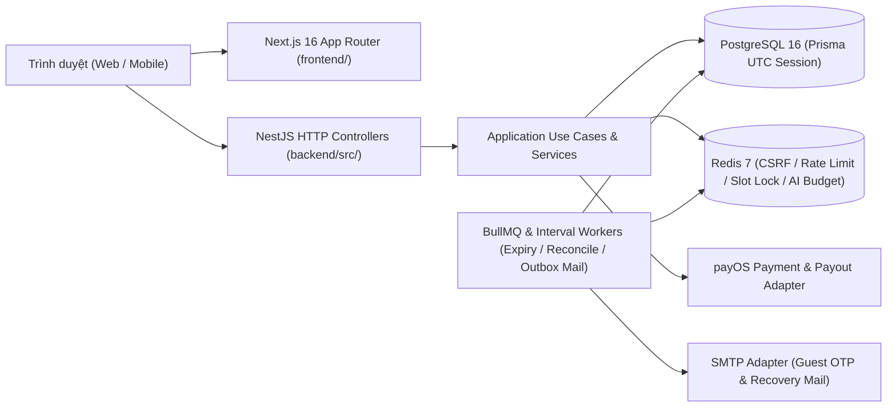

# Kiến trúc hệ thống

Hệ thống đặt sân Pickleball terdiri từ ứng dụng web Next.js 16 (App Router) tại `frontend/` và một NestJS 10 modular monolith tại `backend/`. Backend kết nối một cơ sở dữ liệu PostgreSQL 16 duy nhất qua Prisma (với kết nối được ghim múi giờ phiên `-c timezone=UTC`), sử dụng Redis 7 cho phiên đăng nhập/CSRF/rate-limit/budget AI/khóa tạm bổ trợ, và dùng BullMQ cho các tác vụ nền (thu hồi đơn hết hạn, đối soát thanh toán, gửi thư outbox mã hóa). Toàn bộ kho mã dùng chung một `package.json` và `package-lock.json` tại thư mục gốc.

## Topology runtime



- **Giao tiếp Client – Server**: Trình duyệt gọi trực tiếp NestJS API theo biến môi trường `NEXT_PUBLIC_API_URL` (mặc định `http://localhost:4000` ở môi trường phát triển, tiền tố toàn cục `/api`), kèm cookie `HttpOnly` và header `X-CSRF-Token` (hoặc `X-Booking-Access-Token` / `X-Booking-Checkout-Token` đối với khách vãng lai).
- **Đơn tiến trình Backend**: Các HTTP controllers và các worker nền (`BookingExpiryModule`, `GuestCheckoutReconcileService`, `GuestRecoveryMailWorker`, `PaymentMaintenanceWorker`) được nạp trong cùng tiến trình `AppModule`.
- **Cập nhật lịch sân theo thời gian thực**: Scaffold Socket.IO trong `backend/src/modules/notifications/` hiện chưa được nạp vào `AppModule`; giao diện đặt sân dùng cơ chế HTTP polling có kiểm soát (`GET /api/courts/:id/occupancies` và báo giá tự động `POST /api/bookings/quote` có debounce).

## Ranh giới kiến trúc trong mỗi Module

```text
HTTP Controller / Guard / DTO / Presenter (presentation/)
                        |
          Application Use Case / Service (application/)
                        |
                  Port Interface (ports/)
                        |
             Infrastructure Adapter (infrastructure/)
          (Prisma / Redis / BullMQ / payOS / Nodemailer)
```

Mỗi miền nghiệp vụ ưu tiên tách theo các hành động rõ ràng (ví dụ: `CreateHoldUseCase`, `QuoteBookingUseCase`, `CancelBookingUseCase`, `ExpireEligibleHoldsUseCase`, `RequestGuestRecoveryLinkUseCase`) thay vì gom toàn bộ logic vào một service tổng. Các use case giao tiếp với hạ tầng thông qua các Port (`BookingStore`, `CourtScheduleReader`, `BookingSlotLock`, `AccountStore`...) và chia sẻ ngữ cảnh giao dịch PostgreSQL qua `TransactionContext`.

## Phân quyền sở hữu dữ liệu (9 Module nghiệp vụ đang chạy)

| Module trong `AppModule`                 | Trách nhiệm chính và dữ liệu sở hữu                                                                                                                                                                                                                                                                                                                                                                                                                          |
| ---------------------------------------- | ------------------------------------------------------------------------------------------------------------------------------------------------------------------------------------------------------------------------------------------------------------------------------------------------------------------------------------------------------------------------------------------------------------------------------------------------------------ |
| `AuthModule` / `UsersModule`             | Đăng ký, đăng nhập, xác thực OTP tài khoản, làm mới/thu hồi phiên (`users`, `user_profiles`, `user_roles`, `refresh_tokens`), cookie `HttpOnly` và CSRF token.                                                                                                                                                                                                                                                                                               |
| `CourtsModule`                           | Danh mục chi nhánh, sân đang hoạt động (`ACTIVE`), giờ mở cửa, quy tắc giá theo khung giờ (`branches`, `courts`, `branch_business_hours`, `price_rules`) và thuật toán tính giá theo phút (`BigInt HALF_UP`).                                                                                                                                                                                                                                                |
| `BookingsModule` + `BookingExpiryModule` | Báo giá (`quote`), tạo giữ chỗ `HOLDING` 5 phút với mức cọc 30% thống nhất, quản lý khoảng chiếm sân (`bookings`, `court_occupancies`, `booking_price_items`, `booking_status_history`, `booking_cancellation_requests`), tự chữa lành (self-heal) đơn hết hạn trên đường ghi và quét hết hạn qua BullMQ.                                                                                                                                                    |
| `PaymentsModule`                         | Xác thực OTP khách vãng lai (`guest_otp_challenges`, `guest_otp_proofs`), tạo giữ chỗ vãng lai bền vững 2 pha (`guest_checkout_intents`, `payment_requests` trạng thái `CREATING`), tạo mã VietQR payOS, xử lý webhook (`payment_webhook_events`), ghi nhận biên lai (`payment_transactions`), hoàn tiền (`refund_requests`, `refund_attempts`), nhật ký kiểm toán (`payment_audit_logs`), hộp thư mã hóa (`outbox_messages`) và bộ giả lập thanh toán Demo. |
| `CheckInModule`                          | Cấp mã QR check-in một lần (`booking_access_tokens` mục đích `CHECKIN`), xác minh check-in bằng QR hoặc thủ công (`booking_checkins`) và hoàn tất ca chơi (`COMPLETED`).                                                                                                                                                                                                                                                                                     |
| `AiAssistantModule`                      | Hỏi đáp chính sách đặt sân (`/api/ai/chat`), kiểm soát ngân sách token theo ngày/IP bằng Redis (`RedisAiBudgetAdapter`) và đối chiếu cơ sở tri thức nội bộ.                                                                                                                                                                                                                                                                                                  |
| `LegalContentModule`                     | Cung cấp nội dung điều khoản sử dụng, chính sách bảo mật và thông báo thu thập dữ liệu có đánh số phiên bản (`GET /api/legal/:slug`).                                                                                                                                                                                                                                                                                                                        |
| `PrivacyRequestsModule`                  | Tiếp nhận yêu cầu quyền dữ liệu cá nhân (DSR) cho thành viên (`/api/privacy/requests`) và khách vãng lai (`/api/guest/privacy-requests`).                                                                                                                                                                                                                                                                                                                    |
| `SupportModule`                          | Tiếp nhận yêu cầu hỗ trợ khách hàng (`POST /api/support/inquiries`).                                                                                                                                                                                                                                                                                                                                                                                         |

Nguồn chuẩn của các bảng và enum là [`backend/prisma/schema.prisma`](../backend/prisma/schema.prisma) cùng chuỗi 11 migration SQL trong `backend/prisma/migrations/`. Các module không truy cập xuyên biên giới adapter riêng của nhau mà giao tiếp qua Port hoặc dịch vụ được export tường minh.

## Giao dịch cơ sở dữ liệu và tính toàn vẹn

1. **Bất biến lịch sân tại PostgreSQL**: Việc tạo giữ chỗ (`HOLDING`), lưu chi tiết giá (`booking_price_items`), ghi lịch sử trạng thái (`booking_status_history`) và chèn khoảng chiếm sân (`court_occupancies`) luôn diễn ra trong cùng một giao dịch PostgreSQL. Ràng buộc loại trừ (`Exclusion Constraint` dùng `btree_gist` trên `court_id` và khoảng nửa mở `[occupied_from, occupied_until)` với `state = 'ACTIVE'`) là chốt chặn quyết định chống trùng lịch. `RedisBookingSlotLock` được nối trong `BookingsModule` như lớp khóa phân tán bổ trợ để giảm tranh chấp sớm, không thay thế ràng buộc trong PostgreSQL.
2. **Giữ chỗ và thanh toán khách vãng lai bền vững 2 pha (Two-Phase Guest Checkout)**:
   - **Pha 1 (Trong giao dịch PostgreSQL)**: Xác thực `GuestOtpProof`, tạo `Booking` (`HOLDING`, cọc 30%), `CourtOccupancy`, `GuestCheckoutIntent`, đồng thời tạo ngay bản ghi `PaymentRequest` ở trạng thái `CREATING` (khóa chuẩn `pay_guest_{bookingId}`) và ghi thông điệp khôi phục mã hóa AES-256-GCM vào `outbox_messages`.
   - **Pha 2 (Ngoài giao dịch DB)**: Gọi cổng payOS để lấy chuỗi EMVCo VietQR và chuyển `PaymentRequest` sang `PENDING`. Nếu cuộc gọi mạng sang cổng thanh toán gặp sự cố hoặc trình duyệt bị đóng giữa chừng, worker `GuestCheckoutReconcileService` hoặc yêu cầu tiếp tục từ khách sẽ hoàn tất Pha 2 trên cùng bản ghi `PaymentRequest` mà không tạo đơn hay yêu cầu thu trùng lặp.
3. **Chuẩn hóa múi giờ phiên DB**: `PrismaService` tự động bổ sung `options=-c timezone=UTC` vào chuỗi kết nối PostgreSQL, đảm bảo mọi hàm thời gian phía DB (`clock_timestamp()`, `NOW()`) đồng nhất tuyệt đối với thời gian UTC của ứng dụng.

## Tài liệu liên quan

- [Bản đồ mã nguồn (CODEBASE-MAP.md)](CODEBASE-MAP.md)
- [Kiến trúc Backend (BACKEND-ARCHITECTURE.md)](BACKEND-ARCHITECTURE.md)
- [Kiến trúc Frontend (FRONTEND-ARCHITECTURE.md)](FRONTEND-ARCHITECTURE.md)
- [Tài liệu API (API.md)](API.md)
- [Cơ sở dữ liệu (DATABASE.md)](DATABASE.md) và [Thiết kế CSDL chi tiết (DATABASE-DESIGN.md)](DATABASE-DESIGN.md)
