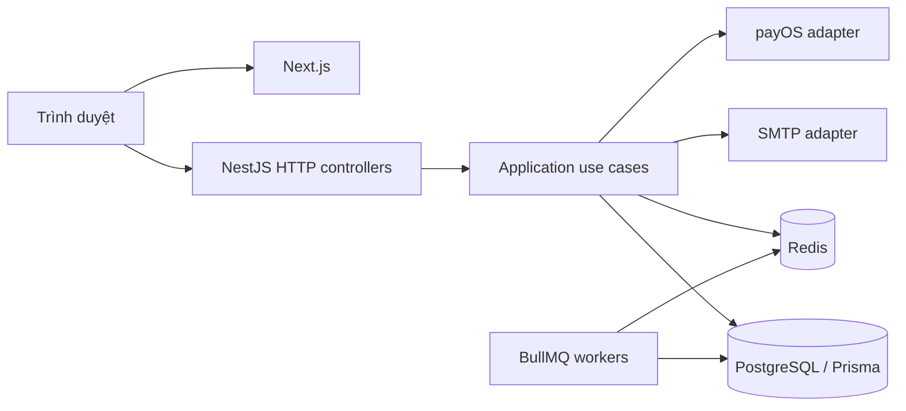

# Kiến trúc hệ thống

Hệ thống gồm Next.js frontend và một NestJS modular monolith. Backend kết nối một PostgreSQL database qua Prisma, dùng Redis cho session/CSRF/rate limit và BullMQ cho tác vụ nền. Root manifest/lockfile quản lý dependency chung.

## Topology runtime



Client gọi Nest API theo `NEXT_PUBLIC_API_URL`, không có Next proxy bắt buộc. API và workers được nối trong cùng backend process qua AppModule và các module con. Compose local chỉ chạy hạ tầng, chưa đóng gói/deploy API hoặc web. Socket.IO scaffold không được import vào AppModule; lịch hiện dùng HTTP polling.

## Ranh giới code

```text
HTTP controller / DTO / presenter
                |
        Application use case
                |
             Port
                |
     Infrastructure adapter
       Prisma / Redis / SDK
```

Use case điều phối một mục tiêu nghiệp vụ; adapter implement port và được DI ở module. Một số thành phần còn dùng Nest DI và Prisma transaction alias trong application, nên chưa phải lõi hoàn toàn độc lập framework. Không cần generic repository để bọc mọi Prisma call.

## Ownership dữ liệu

| Module                    | Trách nhiệm                                               |
| ------------------------- | --------------------------------------------------------- |
| Auth / Users              | Account, current roles, phiên và hồ sơ                    |
| Courts                    | Branch, court, giờ mở cửa và quy tắc giá                  |
| Bookings                  | Hold, occupancy, snapshot giá, history và cancellation    |
| Payments                  | Guest checkout/OTP, request/receipt/webhook, audit/refund |
| Check-in                  | Cấp/consume token, check-in QR/thủ công và complete       |
| Legal / Privacy / Support | Policy và tiếp nhận yêu cầu theo adapter hiện hành        |
| Notifications / workers   | Tác vụ nền và delivery; sink/realtime còn giới hạn        |

Nguồn model/enum là [schema](../backend/prisma/schema.prisma); SQL constraint nằm trong migration. Privacy/support không tự trở thành Prisma model chỉ vì có module. Không deep-import adapter riêng hoặc sửa persistence miền khác tùy tiện; invariant xuyên miền thuộc use case/transaction rõ.

## Transaction và tích hợp

Booking, snapshot giá, occupancy và history phải nhất quán trong PostgreSQL transaction. Exclusion constraint bảo vệ overlap của occupancy ACTIVE, gồm cleanup buffer. Redis lock không thay invariant DB; core booking không dùng Redis lock.

Transaction DB không atomic với Redis, SMTP hoặc ngân hàng. Payment dùng idempotency/inbox/receipt, điều phối xác nhận và outbox để giữ evidence; tác vụ retry/đối soát cần biết trạng thái UNKNOWN, không gửi tiền lại mù. Worker tồn tại chưa chứng minh delivery thành công.

## Cấu trúc và giới hạn

[Bản đồ source](CODEBASE-MAP.md) định vị thư mục; [backend](BACKEND-ARCHITECTURE.md) và [frontend](FRONTEND-ARCHITECTURE.md) mô tả chi tiết. Generated client, `backend/dist/` và `frontend/.next/` là output, không phải nguồn thiết kế.

Production topology, worker scaling, audit sink, SMTP/provider, backup/restore và SLO cần được xác nhận trong môi trường đích. Không suy deployment từ CI. Xem [Operations](OPERATIONS.md), [Configuration](CONFIGURATION.md) và [Release requirements](RELEASE-REQUIREMENTS.md).
