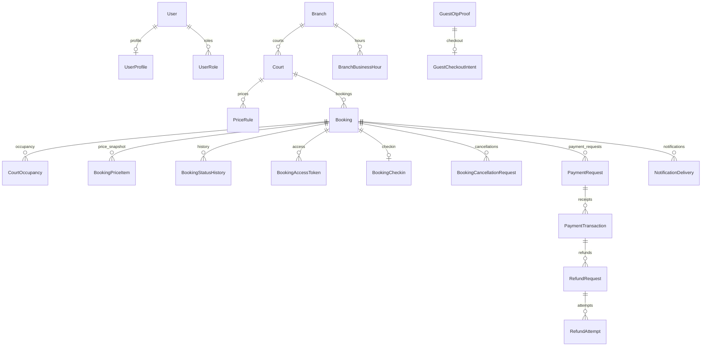

# Cơ sở dữ liệu

Tóm tắt schema PostgreSQL để định vị nhanh. Nguồn model/enum là [`backend/prisma/schema.prisma`](../backend/prisma/schema.prisma); migration SQL có constraint không biểu diễn hết trong Prisma nằm ở `backend/prisma/migrations/`. Schema/migration v1 đã được tạo trong repository; trạng thái áp dụng phải kiểm tra trên đúng database đích.

## Phạm vi và nhóm model

Schema hiện có 27 model trong một PostgreSQL database và schema `public`:

| Miền               | Model (Prisma)                                                                                                              | Bảng                                                                                                                                       |
| ------------------ | --------------------------------------------------------------------------------------------------------------------------- | ------------------------------------------------------------------------------------------------------------------------------------------ |
| Tài khoản và quyền | `User`, `UserProfile`, `UserRole`, `RefreshToken`                                                                           | `users`, `user_profiles`, `user_roles`, `refresh_tokens`                                                                                   |
| Cơ sở và sân       | `Branch`, `Court`, `BranchBusinessHour`, `PriceRule`                                                                        | `branches`, `courts`, `branch_business_hours`, `price_rules`                                                                               |
| Booking            | `Booking`, `CourtOccupancy`, `BookingPriceItem`, `BookingStatusHistory`, `BookingAccessToken`, `BookingCancellationRequest` | `bookings`, `court_occupancies`, `booking_price_items`, `booking_status_history`, `booking_access_tokens`, `booking_cancellation_requests` |
| Check-in           | `BookingCheckin`                                                                                                            | `booking_checkins`                                                                                                                         |
| Thu và hoàn tiền   | `PaymentRequest`, `PaymentTransaction`, `PaymentWebhookEvent`, `RefundRequest`, `RefundAttempt`                             | `payment_requests`, `payment_transactions`, `payment_webhook_events`, `refund_requests`, `refund_attempts`                                 |
| Thông báo          | `NotificationDelivery`                                                                                                      | `notification_deliveries`                                                                                                                  |
| Tích hợp nền       | `OutboxEvent`, `OutboxMessage`                                                                                              | `outbox_events`, `outbox_messages`                                                                                                         |

Các model bổ sung so với thiết kế v1: `PaymentAuditLog` (`payment_audit_logs`), `GuestOtpChallenge` (`guest_otp_challenges`), `GuestOtpProof` (`guest_otp_proofs`), `GuestCheckoutIntent` (`guest_checkout_intents`) và `OutboxMessage` (`outbox_messages`). Chúng lưu audit và lifecycle guest/outbox theo schema/migration hiện hành; không suy ra email đã gửi chỉ từ hàng outbox.

## Quan hệ chính

`OutboxEvent` là hàng đợi sự kiện trong cùng DB, liên kết aggregate bằng type/id thay vì FK tới mọi domain. Sơ đồ lược bỏ một số FK kiểm toán tới user và chi nhánh; xem schema khi cần quan hệ chính xác.

## Quy ước dữ liệu và ràng buộc

- ID là UUID; migration dùng `gen_random_uuid()` cho ID tự sinh.
- Tiền VND dùng `NUMERIC(14,0)`, không dùng số thực. Phần trăm dùng `NUMERIC(5,2)`.
- Thời điểm nghiệp vụ dùng `TIMESTAMPTZ`; giờ mở cửa tuần dùng kiểu `TIME` và múi giờ chi nhánh.
- Status, role, phương thức và loại sự kiện là PostgreSQL enum được ánh xạ từ Prisma.
- FK cùng database giữ toàn vẹn liên miền; phần lớn quan hệ khai báo `ON DELETE RESTRICT`. Không suy luận cascade/xóa mềm nếu schema không khai báo.
- Schema không có cột xóa mềm dùng chung. Booking, giao dịch, refund và lịch sử là dữ liệu cần giữ theo thiết kế; retention và ẩn PII cần chính sách riêng.
- Migration SQL có CHECK, unique index dạng partial/expression và exclusion constraint cho khoảng chiếm sân đang hoạt động. Không bỏ các constraint SQL-only khi tạo migration tiếp theo.
- Dùng idempotency key/deduplication ở các thao tác tương ứng. Ghi outbox trong cùng transaction với thay đổi nghiệp vụ; publish thành công không đồng nghĩa email hay nghiệp vụ đã hoàn tất.

## Điểm cần thận trọng

`CourtOccupancy` là nơi bảo vệ khoảng sân; `occupiedUntil` đã gồm thời gian vệ sinh theo snapshot booking. Invariant tổng hợp nhiều dòng, như tổng tiền đã nhận/hoàn, vẫn cần transaction và logic ứng dụng.

Booking MVP dùng unique `(userId, idempotencyKey)` qua migration `20261016090000_booking_user_idempotency`; guest vẫn có partial unique riêng. Exclusion hiện có được giữ nguyên. Luồng giá/snapshot/expiry/hủy xem [BOOKING-MVP.md](BOOKING-MVP.md).

Schema/migration không chứng minh database đã được migrate, seed hoặc có dữ liệu. Dùng [PIPELINES.md](PIPELINES.md) và [OPERATIONS.md](OPERATIONS.md) cho lệnh; kiểm tra trạng thái ở môi trường được giao trước khi kết luận.

## Snapshot tiền cọc và policy tạo mới

Migration `20261026000000_guest_deposit_policy` gỡ riêng CHECK `bookings_guest_full_prepayment_check` từng ép guest trả 100%. Member và Guest tạo hold mới đều được use case bắt buộc cọc 30%; database giữ `NUMERIC(5,2)` và miền snapshot 30/100 để đọc booking 100% lịch sử, không biến policy hiện hành thành enum chỉ còn 30. Các CHECK tổng tiền, khoản trả trước, snapshot 100% phải đủ tổng và exclusion occupancy không đổi. Raw SQL/import không thay thế validation policy tạo mới tại ứng dụng.

Migration không UPDATE/backfill booking, receipt hay policy snapshot. ALTER TABLE có lock timeout 5 giây, statement timeout 30 giây và transaction; cần cửa sổ vận hành phù hợp khi được cấp quyền triển khai. Không chạy lên production trong task sửa này. Không rollback bằng cách áp lại CHECK guest 100% khi đã có booking guest 30%, hoặc đổi tiền lịch sử để vượt CHECK; cần đánh giá tương thích ứng dụng và dữ liệu trước.

`npm run test:booking:deposit:integration` dùng PostgreSQL thật, toàn bộ SQL migration cũ rồi migration mới trên database rỗng riêng `booking_deposit_test`; có repro SQLSTATE 23514 trước upgrade, giữ lịch sử 100%, tạo Member/Guest 30% qua use case/Prisma thật, từ chối input 100% mới, kiểm CHECK tiền và rollback khi trùng occupancy. Xem [pipeline](PIPELINES.md) để cấu hình an toàn.
