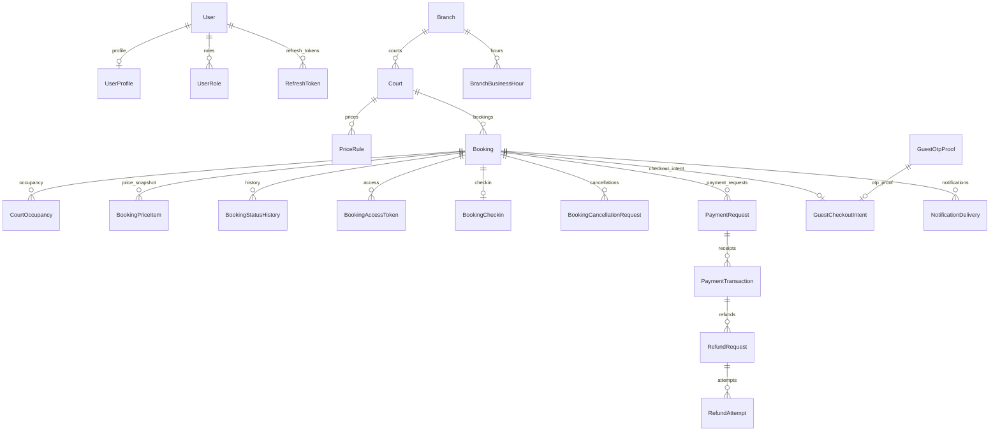

# Cơ sở dữ liệu

Tóm tắt schema PostgreSQL để định vị nhanh. Nguồn chuẩn cho model và enum là [`backend/prisma/schema.prisma`](../backend/prisma/schema.prisma); chuỗi 11 migration SQL chứa các CHECK, partial unique index và exclusion constraint không biểu diễn hết được trong Prisma nằm tại `backend/prisma/migrations/`. Trạng thái áp dụng thực tế phải kiểm tra trên database đích.

## Phạm vi và nhóm model

Schema hiện có **27 model** và **27 enum** trong một PostgreSQL database (schema `public`):

| Miền                                         | Model (Prisma)                                                                                                              | Bảng PostgreSQL                                                                                                                            |
| -------------------------------------------- | --------------------------------------------------------------------------------------------------------------------------- | ------------------------------------------------------------------------------------------------------------------------------------------ |
| Tài khoản và quyền (4)                       | `User`, `UserProfile`, `UserRole`, `RefreshToken`                                                                           | `users`, `user_profiles`, `user_roles`, `refresh_tokens`                                                                                   |
| Cơ sở và sân (4)                             | `Branch`, `Court`, `BranchBusinessHour`, `PriceRule`                                                                        | `branches`, `courts`, `branch_business_hours`, `price_rules`                                                                               |
| Booking (6)                                  | `Booking`, `CourtOccupancy`, `BookingPriceItem`, `BookingStatusHistory`, `BookingAccessToken`, `BookingCancellationRequest` | `bookings`, `court_occupancies`, `booking_price_items`, `booking_status_history`, `booking_access_tokens`, `booking_cancellation_requests` |
| Check-in (1)                                 | `BookingCheckin`                                                                                                            | `booking_checkins`                                                                                                                         |
| Thu, hoàn tiền và kiểm toán (6)              | `PaymentRequest`, `PaymentTransaction`, `PaymentWebhookEvent`, `RefundRequest`, `RefundAttempt`, `PaymentAuditLog`          | `payment_requests`, `payment_transactions`, `payment_webhook_events`, `refund_requests`, `refund_attempts`, `payment_audit_logs`           |
| Xác thực OTP và khôi phục khách vãng lai (3) | `GuestOtpChallenge`, `GuestOtpProof`, `GuestCheckoutIntent`                                                                 | `guest_otp_challenges`, `guest_otp_proofs`, `guest_checkout_intents`                                                                       |
| Thông báo (1)                                | `NotificationDelivery`                                                                                                      | `notification_deliveries`                                                                                                                  |
| Tích hợp nền và Outbox (2)                   | `OutboxEvent`, `OutboxMessage`                                                                                              | `outbox_events`, `outbox_messages`                                                                                                         |

So với thiết kế v1 ban đầu (22 bảng), schema hiện hành bổ sung 5 bảng qua các bản migration tiếp theo: `PaymentAuditLog` (`payment_audit_logs`), `GuestOtpChallenge` (`guest_otp_challenges`), `GuestOtpProof` (`guest_otp_proofs`), `GuestCheckoutIntent` (`guest_checkout_intents`) và `OutboxMessage` (`outbox_messages`). Các bảng này lưu nhật ký kiểm toán thanh toán, vòng đời xác thực OTP email khách vãng lai, định danh khôi phục phiên thanh toán (`checkoutIntentId` + `recoverySecretHash`) và hàng đợi gửi thư mã hóa AES-256-GCM; việc tồn tại bản ghi trong `outbox_messages` không đồng nghĩa thư đã vào hộp thư người nhận.

## Quan hệ chính

`OutboxEvent`, `OutboxMessage`, `PaymentAuditLog` và `GuestOtpChallenge` kết nối với nghiệp vụ qua định danh logic (`aggregateId`, `dedupeKey`, `entityId`, `contactKey`) thay vì khóa ngoại vật lý cứng tới mọi bảng để giữ độc lập vòng đời kiểm toán và tác vụ nền. Sơ đồ trên lược bỏ một số khóa ngoại kiểm toán tới `User` và `Branch`; xem [`backend/prisma/schema.prisma`](../backend/prisma/schema.prisma) khi cần tra cứu đầy đủ.

## Danh mục 27 Enum PostgreSQL

| Nhóm                    | Enum trong Prisma (và kiểu PostgreSQL)                                                                                                                                                                                                                                                                                                                                                                                                                     | Giá trị                                                                                                                                                                                                                                                                                                                                                                                                      |
| ----------------------- | ---------------------------------------------------------------------------------------------------------------------------------------------------------------------------------------------------------------------------------------------------------------------------------------------------------------------------------------------------------------------------------------------------------------------------------------------------------- | ------------------------------------------------------------------------------------------------------------------------------------------------------------------------------------------------------------------------------------------------------------------------------------------------------------------------------------------------------------------------------------------------------------ |
| Tài khoản               | `UserStatus` (`user_status`), `Role` (`role`)                                                                                                                                                                                                                                                                                                                                                                                                              | `ACTIVE`, `SUSPENDED`, `CLOSED`; `CUSTOMER`, `STAFF`, `MANAGER`, `ADMIN`                                                                                                                                                                                                                                                                                                                                     |
| Sân bãi                 | `CourtType` (`court_type`), `CourtStatus` (`court_status`), `OccupancyKind` (`occupancy_kind`), `OccupancyState` (`occupancy_state`)                                                                                                                                                                                                                                                                                                                       | `STANDARD`, `VIP`; `ACTIVE`, `INACTIVE`; `BOOKING`, `BLOCK`; `ACTIVE`, `RELEASED`                                                                                                                                                                                                                                                                                                                            |
| Đặt sân                 | `BookingSource` (`booking_source`), `BookingStatus` (`booking_status`), `CancellationRule` (`cancellation_rule`), `ActorType` (`actor_type`), `BookingTokenPurpose` (`booking_token_purpose`), `CancellationRequestStatus` (`cancellation_request_status`)                                                                                                                                                                                                 | `CUSTOMER_WEB`, `STAFF_COUNTER`; `HOLDING`, `CONFIRMED`, `CHECKED_IN`, `COMPLETED`, `EXPIRED`, `CANCELLED`, `NO_SHOW`; `BEFORE_START`, `BEFORE_CHECKIN`; `SYSTEM`, `CUSTOMER`, `GUEST`, `STAFF`; `CHECKIN`, `MANAGE_BOOKING`, `CHECKOUT_RECOVERY`; `QUOTED`, `ACCEPTED`, `APPLIED`, `EXPIRED`, `SUPERSEDED`, `REJECTED`                                                                                      |
| Check-in                | `CheckinMethod` (`checkin_method`)                                                                                                                                                                                                                                                                                                                                                                                                                         | `QR`, `MANUAL`                                                                                                                                                                                                                                                                                                                                                                                               |
| Thanh toán              | `PaymentReferenceType` (`payment_reference_type`), `PaymentPurpose` (`payment_purpose`), `PaymentMethod` (`payment_method`), `PaymentRequestStatus` (`payment_request_status`), `ReceiptMethod` (`receipt_method`), `ReceiptVerificationStatus` (`receipt_verification_status`), `ReceiptAllocationStatus` (`receipt_allocation_status`), `ConfirmationSource` (`confirmation_source`), `WebhookKind` (`webhook_kind`), `WebhookStatus` (`webhook_status`) | `BOOKING`; `PREPAYMENT`, `BALANCE`; `PAYOS_TRANSFER`, `MANUAL_BANK_TRANSFER`, `CASH`; `CREATING`, `PENDING`, `PARTIALLY_PAID`, `PAID`, `CANCELLED`, `EXPIRED`, `FAILED`; `BANK_TRANSFER`, `CASH`; `UNVERIFIED`, `VERIFIED`, `REJECTED`; `UNALLOCATED`, `ALLOCATED`, `REFUND_REQUIRED`; `WEBHOOK`, `PROVIDER_QUERY`, `STAFF`; `PAYMENT`, `PAYOUT`; `RECEIVED`, `PROCESSING`, `PROCESSED`, `FAILED`, `IGNORED` |
| Hoàn tiền               | `RefundReasonType` (`refund_reason_type`), `RefundMethod` (`refund_method`), `RefundStatus` (`refund_status`), `ApprovalSource` (`approval_source`), `RefundAttemptStatus` (`refund_attempt_status`)                                                                                                                                                                                                                                                       | `CUSTOMER_CANCELLATION`, `LATE_PAYMENT`, `OVERPAYMENT`, `MERCHANT_CANCELLATION`; `PAYOS_PAYOUT`, `MANUAL_BANK_TRANSFER`, `CASH`; `REQUESTED`, `APPROVED`, `PROCESSING`, `COMPLETED`, `REJECTED`, `CANCELLED`; `MANAGER`, `SYSTEM_POLICY`; `CREATED`, `SUBMITTED`, `PROCESSING`, `SUCCEEDED`, `FAILED`, `UNKNOWN`                                                                                             |
| Khách vãng lai & Outbox | `GuestOtpProofStatus` (`guest_otp_proof_status`), `GuestCheckoutIntentStatus` (`guest_checkout_intent_status`), `NotificationTemplate` (`notification_template`), `NotificationStatus` (`notification_status`), `OutboxMessageStatus` (`outbox_message_status`)                                                                                                                                                                                            | `ACTIVE`, `CONSUMED`, `EXPIRED`; `COMMITTED`, `EXPIRED`; `BOOKING_CONFIRMED`, `CHECKIN_CODE`, `BOOKING_CANCELLED`, `REFUND_UPDATED`; `QUEUED`, `SENDING`, `SENT`, `FAILED`; `QUEUED`, `SENDING`, `SENT`, `FAILED`, `EXPIRED_SKIPPED`                                                                                                                                                                         |

## Quy ước dữ liệu và kết nối

- **Khóa chính UUID**: sử dụng `gen_random_uuid()` của PostgreSQL 16.
- **Tiền tệ và tỷ lệ**: tiền VND dùng `NUMERIC(14,0)`, không dùng số thực (`float`). Tỷ lệ phần trăm dùng `NUMERIC(5,2)`.
- **Thời gian và múi giờ phiên kết nối**: mọi thời điểm nghiệp vụ dùng `TIMESTAMPTZ`; giờ mở cửa theo thứ dùng `TIME` kết hợp múi giờ chi nhánh (`Asia/Ho_Chi_Minh`). `PrismaService` tự động gắn tham số `-c timezone=UTC` vào `DATABASE_URL` khi khởi tạo pool kết nối để đảm bảo `clock_timestamp()` và phép so sánh `TIMESTAMPTZ` trên PostgreSQL không bị lệch theo múi giờ máy chủ.
- **Toàn vẹn khóa ngoại và lịch sử**: phần lớn quan hệ dùng `ON DELETE RESTRICT` để bảo vệ chứng từ booking, thanh toán, hoàn tiền và lịch sử trạng thái. Schema không dùng cột xóa mềm (`deleted_at`) đại trà.
- **Ràng buộc mức SQL**: các biểu thức `CHECK`, partial unique index, expression unique index (`LOWER(email)`, `LOWER(username)`) và exclusion constraint (`btree_gist` trên `court_occupancies`) được định nghĩa trực tiếp trong `backend/prisma/migrations/`.

## Chuỗi 11 Migration hiện hành

1. `20261009000100_v1_initial`: khởi tạo 21 bảng nghiệp vụ, `outbox_events`, các enum, khóa ngoại, `CHECK` và exclusion constraint `court_occupancies_no_overlap_active`.
2. `20261013082736_updated_user_optional_v2_edit`: siết `users.username` và `users.email` thành `NOT NULL`.
3. `20261013090000_normalize_auth_phone`: chuẩn hóa số điện thoại tài khoản về dạng `0xxxxxxxxx` (10 chữ số) và thêm `CHECK` regex định dạng điện thoại Việt Nam.
4. `20261016090000_booking_user_idempotency`: chuyển unique idempotency của Member sang cặp `(user_id, idempotency_key)` trong khi giữ partial unique index riêng cho khách vãng lai (`user_id IS NULL`).
5. `20261021000000_payments_m03_metadata`: bổ sung `viet_qr_payload`, `provider_account_name`, `provider_bin` vào bảng `payment_requests`.
6. `20261022000000_payments_audit_log`: tạo bảng `payment_audit_logs` lưu dấu vết kiểm toán thu/hoàn tiền và đối soát.
7. `20261026000000_guest_deposit_policy`: gỡ `CHECK` `bookings_guest_full_prepayment_check` để đồng nhất chính sách đặt cọc **30%** cho cả Member và Guest đối với các đơn giữ chỗ mới, đồng thời giữ tương thích đọc cho các snapshot 100% lịch sử.
8. `20261029000000_guest_checkout_recovery_contracts`: thêm giá trị `CHECKOUT_RECOVERY` vào `booking_token_purpose`, tạo các bảng `guest_otp_proofs`, `guest_checkout_intents` và `outbox_messages`.
9. `20261029010000_guest_checkout_recovery_remediation`: siết `guest_checkout_intents.otp_proof_id` thành `NOT NULL` và bổ sung cột `purged_at` cùng `CHECK` `outbox_messages_payload_shape_check` (cho phép xóa trắng bản mã `payload_ciphertext`, `payload_iv`, `payload_auth_tag` sau khi thư đã kết thúc vòng đời mà vẫn giữ hàng tombstone chống gửi trùng theo `dedupe_key`).
10. `20261029020000_guest_otp_challenges`: tạo bảng `guest_otp_challenges` lưu thử thách OTP 6 số, bộ đếm số lần thử sai, thời gian khóa (`locked_until`) và chống gửi trùng trong cửa sổ thời gian.
11. `20261031000000_allow_zero_cleanup`: cập nhật `courts_cleanup_minimum_check` và `bookings_cleanup_minimum_check` từ `>= 15` sang `>= 0` (giá trị mặc định trong Prisma schema là `@default(0)`), cho phép cấu hình sân không cộng thời gian nghỉ vệ sinh hoặc cấu hình số phút vệ sinh tùy theo sân.

## Điểm cần thận trọng

- **Bảo vệ lịch sân (`CourtOccupancy`)**: `occupiedUntil` luôn bằng `endsAt + cleanupMinutes` theo snapshot của booking. Khi `cleanupMinutes = 0`, khoảng chiếm sân khớp đúng khung giờ chơi `[startsAt, endsAt)`.
- **Đặt cọc 30% thống nhất**: cả Member và Guest khi tạo đơn mới đều bắt buộc đặt cọc 30% (`prepayment_percent = 30.00`). Cột `prepayment_percent` trong DB vẫn cho phép tập giá trị `{30.00, 100.00}` để đọc các đơn 100% lịch sử mà không cần sửa dữ liệu cũ.
- **Kiểm tra tích hợp DB**: script `npm run test:booking:deposit:integration` chạy toàn bộ chuỗi migration trên database kiểm thử riêng để xác minh các ràng buộc SQL và use case đặt sân. Xem [PIPELINES.md](PIPELINES.md) và [OPERATIONS.md](OPERATIONS.md) để biết chi tiết lệnh chạy.
