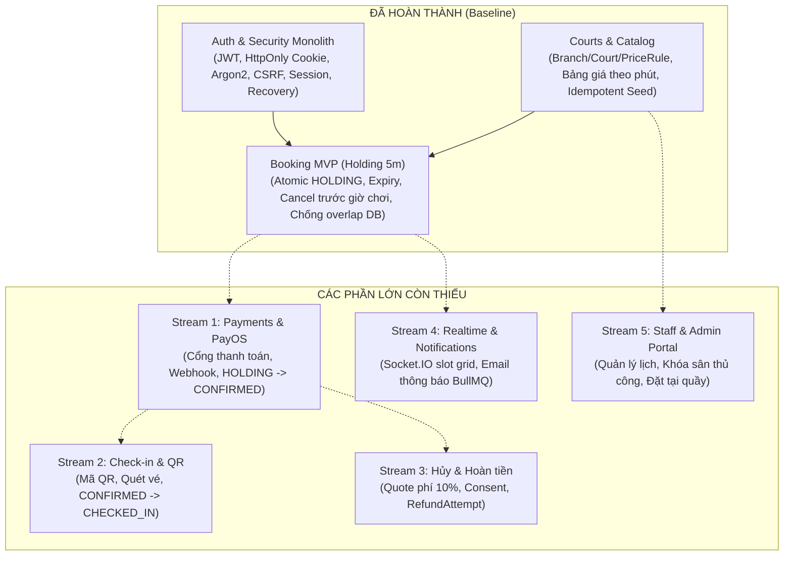

# Tổng kết Tiến độ Dự án & Bản đồ Phân chia Git Worktree

Tài liệu này tổng hợp hiện trạng tiến độ (processing) của hệ thống Pickleball Booking, phân rã các module lớn còn thiếu và định nghĩa các luồng công việc (Work Streams) độc lập nhằm tối ưu hóa việc phân chia **Git Worktree**, giảm thiểu tối đa xung đột mã nguồn và cơ sở dữ liệu.

---

## 1. Hiện trạng Tiến độ Dự án (Current Progress)

Dự án hiện là một **Modular Monolith** kết hợp Next.js App Router (Frontend) và NestJS (Backend), chia sẻ một cơ sở dữ liệu PostgreSQL chung qua Prisma.



### Các phần đã hoàn thành và kiểm chứng cục bộ (Done)
1. **Nền tảng Auth & Bảo mật:**
   - Đăng ký, đăng nhập đa định danh (username, email, SĐT Việt Nam), phát hành JWT lưu trong HttpOnly Cookie.
   - Cơ chế thu hồi phiên (`tokenVersion`), chống brute-force với Redis throttling, kiểm tra mật khẩu yếu/HIBP, bảo vệ CSRF.
   - Frontend AuthContext, modal đăng nhập/đăng ký, form validation chống spam click và hỗ trợ chế độ khách (Guest).
2. **Quản lý Sân & Bảng giá (Courts & Pricing):**
   - Mô hình `Branch`, `Court`, `PriceRule` theo khung giờ thường/cao điểm và ngày trong tuần.
   - Động cơ tính giá snapshot theo phút (làm tròn HALF_UP từng dòng VND), kiểm tra tính sẵn sàng có kèm đệm vệ sinh 15 phút.
   - API `GET /api/courts`, giao diện Catalog trang chủ và trang chi tiết sân `/courts/[courtId]`.
3. **Giữ chỗ lõi (Booking MVP - Phase 1):**
   - Giữ sân trạng thái `HOLDING` trong 5 phút; PostgreSQL Exclusion Constraint ngăn chặn tuyệt đối đặt trùng lịch (kể cả 15 phút dọn sân).
   - Idempotency key chống tạo trùng đơn; worker BullMQ dọn hold hết hạn (kèm self-heal ở write path) tự động giải phóng lịch.
   - Hủy giữ chỗ chưa thanh toán do chính chủ thực hiện trước giờ bắt đầu.
   - Frontend quản lý đặt chỗ tại `/bookings` (xem danh sách, hủy giữ chỗ).

---

## 2. Các Module Lớn Còn Thiếu & Phân rã Worktree Streams

Để phát triển song song hiệu quả bằng **Git Worktree**, hệ thống được chia thành **5 Work Streams lớn**. Mỗi stream sở hữu ranh giới thư mục rõ ràng, hạn chế tối đa việc chỉnh sửa chéo các file trung tâm (`app.module.ts`, `schema.prisma`).

```text
┌───────────────────────────────────────────────────────────────────────────────────┐
│                           BẢN ĐỒ PHÂN CHIA WORKTREE                               │
├─────────────────────┬───────────────────────────────────────┬─────────────────────┤
│ Worktree Stream     │ Trọng tâm Backend                     │ Trọng tâm Frontend  │
├─────────────────────┼───────────────────────────────────────┼─────────────────────┤
│ 1. Payments & PayOS │ backend/src/modules/payments/         │ frontend/app/       │
│                     │ - Tạo payment request (30% / 100%)    │   checkout/         │
│                     │ - Webhook PayOS & Chữ ký HMAC         │ - QR PayOS modal    │
│                     │ - Chuyển trạng thái CONFIRMED         │ - Kết quả checkout  │
├─────────────────────┼───────────────────────────────────────┼─────────────────────┤
│ 2. Check-in & QR    │ backend/src/modules/check-in/         │ frontend/app/       │
│                     │ - Sinh token & mã QR check-in         │   staff/check-in/   │
│                     │ - Endpoint verify (QR / thủ công)     │ - Màn hình vé khách │
│                     │ - Kiểm tra trả đủ 100% trước vào sân  │ - Máy quét QR staff │
├─────────────────────┼───────────────────────────────────────┼─────────────────────┤
│ 3. Cancel & Refund  │ backend/src/modules/bookings/ (cancel)│ frontend/components/│
│                     │ backend/src/modules/payments/ (refund)│   booking/cancel-   │
│                     │ - Quote phí phạt 10% & consent khách  │   quote-modal.tsx   │
│                     │ - Quản lý RefundRequest/RefundAttempt │ - Lịch sử hoàn tiền │
├─────────────────────┼───────────────────────────────────────┼─────────────────────┤
│ 4. Notifications    │ backend/src/modules/notifications/    │ frontend/hooks/     │
│    & Realtime       │ - Kích hoạt Socket.IO (handshake auth)│   use-realtime-grid │
│                     │ - BullMQ queue gửi email thông báo    │ - Toast thông báo   │
│                     │ - Template: Confirmed, QR, Cancelled  │ - Live slot updates │
├─────────────────────┼───────────────────────────────────────┼─────────────────────┤
│ 5. Staff & Admin    │ backend/src/modules/courts/ (admin)   │ frontend/app/admin/ │
│    Management       │ backend/src/modules/users/ (staff)    │ - Quản lý cụm/sân   │
│                     │ - Khóa sân bảo trì (CourtBlock)       │ - Timeline đặt sân  │
│                     │ - Đặt sân tại quầy (STAFF_COUNTER)    │ - Cấu hình bảng giá │
└─────────────────────┴───────────────────────────────────────┴─────────────────────┘
```

---

### Stream 1: Cổng thanh toán & Webhook (Payments & PayOS)
> **Mục tiêu:** Đưa đơn đặt sân từ `HOLDING` sang `CONFIRMED` thông qua thanh toán thực tế.
- **Ranh giới Backend (`backend/src/modules/payments/`):**
  - Tạo `PaymentRequest` (hỗ trợ cọc 30% cho Member hoặc 100% cho Guest/Member).
  - Tích hợp SDK/API PayOS (tạo link thanh toán, mã VietQR động).
  - Endpoint tiếp nhận Webhook: `POST /api/payments/webhook`:
    - Xác thực chữ ký webhook (HMAC SHA256).
    - Bảo đảm tính Idempotent (chống xử lý lặp sự kiện).
    - Cập nhật `PaymentTransaction` và kích hoạt chuyển trạng thái booking sang `CONFIRMED`.
    - Xử lý đơn thanh toán muộn (sau khi đã hết hạn 5 phút): đưa vào danh sách đối soát/hoàn tiền, không tự tiện kích hoạt lại booking đã `EXPIRED`.
- **Ranh giới Frontend:**
  - Route `/checkout/[bookingId]`: hiển thị thông tin tiền cọc/toàn bộ, mã QR PayOS và bộ đếm ngược thời gian thanh toán.
  - Trang phản hồi kết quả: `/checkout/success`, `/checkout/expired`.
- **Model liên quan (đã có sẵn trong Schema):** `PaymentRequest`, `PaymentTransaction`, `PaymentWebhookEvent`.

---

### Stream 2: Check-in & Xác thực QR (Check-in & QR Verification)
> **Mục tiêu:** Xác thực khách vào sân bằng mã QR hoặc nghiệp vụ quầy của nhân viên.
- **Ranh giới Backend (`backend/src/modules/check-in/`):**
  - Tạo `BookingToken` (loại `CHECKIN`, có chữ ký bảo mật/thời hạn).
  - Endpoint `POST /api/check-in/verify`:
    - Giải mã token hoặc nhận mã check-in từ nhân viên quầy (`MANUAL` hoặc `QR`).
    - Kiểm tra điều kiện: chỉ duyệt khi booking `CONFIRMED`, đúng ngày giờ (cho phép sớm tối đa X phút theo chính sách).
    - Thu nốt 70% còn lại nếu khách mới đặt cọc 30% (tạo giao dịch thanh toán tại quầy).
    - Chuyển trạng thái booking sang `CHECKED_IN` và sau giờ chơi chuyển `COMPLETED`.
- **Ranh giới Frontend:**
  - Customer view: Component hiển thị thẻ vé điện tử kèm mã QR trong `/bookings/[bookingId]`.
  - Staff portal: Route `/staff/check-in` cho phép nhân viên dùng camera quét QR hoặc gõ mã vé tra cứu nhanh.
- **Model liên quan:** `BookingCheckin`, `BookingToken`.

---

### Stream 3: Chính sách Hủy & Hoàn tiền (Cancellation & Refunds)
> **Mục tiêu:** Xử lý hủy đơn sau khi đã thanh toán (`CONFIRMED`), tính phí phạt minh bạch và đối soát hoàn tiền.
- **Ranh giới Backend:**
  - Endpoint báo giá hủy: `POST /api/bookings/:id/cancel-quote` tính toán phí hủy (ví dụ 10% tổng giá trị theo thiết kế), tạo `BookingCancellationRequest` ở trạng thái `QUOTED`.
  - Endpoint áp dụng hủy: `POST /api/bookings/:id/cancel-apply` sau khi khách xác nhận đồng ý (`ACCEPTED`), chuyển trạng thái booking thành `CANCELLED`, giải phóng `CourtOccupancy`.
  - Khởi tạo `RefundRequest` với số tiền thực hoàn = (Tiền đã thanh toán - Phí phạt).
  - Tích hợp cổng Payout PayOS hoặc quy trình duyệt chuyển khoản thủ công qua `RefundAttempt`.
- **Ranh giới Frontend:**
  - Modal hủy đặt sân nâng cao: Cảnh báo chính sách phạt, hiển thị số tiền sẽ được hoàn, yêu cầu checkbox xác nhận.
  - Quản lý trạng thái hoàn tiền trong chi tiết đặt chỗ.
- **Model liên quan:** `BookingCancellationRequest`, `RefundRequest`, `RefundAttempt`.

---

### Stream 4: Thông báo, Email & Realtime (Notifications & Realtime Grid)
> **Mục tiêu:** Cập nhật lưới sân thời gian thực và tự động gửi email xác nhận.
- **Ranh giới Backend (`backend/src/modules/notifications/`):**
  - Kích hoạt và hoàn thiện `realtime.gateway.ts` (Socket.IO):
    - Xác thực JWT trong WebSocket handshake.
    - Phát sự kiện `court:locked` / `court:released` cho toàn bộ client đang xem lịch khi có ai đó bắt đầu giữ chỗ hoặc hủy đơn.
  - Tích hợp dịch vụ gửi mail (SMTP thật / Resend / SendGrid) qua BullMQ queue:
    - Gửi email xác nhận đặt sân kèm mã vé và tóm tắt lịch trình.
    - Gửi email nhắc nhở trước giờ chơi hoặc thông báo hủy/hoàn tiền.
- **Ranh giới Frontend:**
  - Hook `useRealtimeCourt(courtId, date)`: Lắng nghe socket để đổi màu ô lịch (xám/đỏ) ngay lập tức mà không cần F5.
- **Model liên quan:** `NotificationLog`.

---

### Stream 5: Cổng Quản trị & Nhân viên (Staff & Admin Management)
> **Mục tiêu:** Giúp chủ sân quản lý lịch trình toàn cụm, can thiệp thủ công và quản lý tài chính.
- **Ranh giới Backend:**
  - Module quản trị sân: Thêm/sửa sân, cập nhật trạng thái sân (`ACTIVE`/`INACTIVE`), tạo bảng giá `PriceRule` linh hoạt.
  - Cơ chế khóa sân bảo trì: Tạo bản ghi `CourtOccupancy` loại `BLOCK` qua bảng `CourtBlock` để chặn khách đặt.
  - Đặt sân trực tiếp tại quầy: Endpoint cho nhân viên tạo booking `STAFF_COUNTER` thanh toán tiền mặt/chuyển khoản trực tiếp.
- **Ranh giới Frontend (`frontend/app/admin/`):**
  - Màn hình lịch biểu tổng quan (Master Timeline Grid) hiển thị tất cả các sân theo trục thời gian.
  - Công cụ kéo/thả hoặc click chọn khoảng giờ để khóa sân bảo trì hoặc đặt chỗ nhanh cho khách vãng lai.
- **Model liên quan:** `CourtBlock`, `CourtOccupancy`, `UserRole` (`STAFF`, `MANAGER`, `ADMIN`).

---

## 3. Chiến lược Tổ chức Git Worktree Không Xung đột

Khi tạo các worktree để làm việc song song, áp dụng các nguyên tắc sau:

### 1. Phân định nhánh và thư mục Worktree
Khuyến nghị tạo thư mục `worktrees/` ngang hàng hoặc nằm ngoài thư mục chính:
```powershell
# Tạo worktree cho Stream 1 (Payments)
git worktree add ../booking-stream-payments -b feature/payments-payos

# Tạo worktree cho Stream 2 (Check-in)
git worktree add ../booking-stream-checkin -b feature/checkin-qr

# Tạo worktree cho Stream 4 (Notifications & Realtime)
git worktree add ../booking-stream-realtime -b feature/notifications-realtime
```

### 2. Quy tắc cô lập mã nguồn (Isolation Rules)
- **Schema & Migration:** Toàn bộ 22 model cốt lõi đã được định nghĩa sẵn trong [schema.prisma](file:///C:/Users/Admin/Documents/booking-project/backend/prisma/schema.prisma). Các worktree **tránh tự ý sửa đổi schema chung** trừ khi thật sự cần thiết. Điều này giúp ngăn chặn xung đột lịch sử Prisma migration.
- **Backend AppModule:** Mỗi stream chỉ đăng ký module của mình vào [backend/src/app.module.ts](file:///C:/Users/Admin/Documents/booking-project/backend/src/app.module.ts). Khi merge, conflict tại file này rất đơn giản (chỉ là các dòng import module độc lập).
- **Frontend Routes:** Mỗi stream phát triển trên các route Next.js tách biệt (`/checkout`, `/staff`, `/admin`, component độc lập), tránh sửa đè lên [frontend/app/page.tsx](file:///C:/Users/Admin/Documents/booking-project/frontend/app/page.tsx) hoặc logic cốt lõi của [frontend/context/auth-context.tsx](file:///C:/Users/Admin/Documents/booking-project/frontend/context/auth-context.tsx).

### 3. Quản lý Môi trường & Database giữa các Worktree
- Mỗi worktree cần copy file cấu hình môi trường `.env` và `backend/.env.test`.
- Khi chạy kiểm thử hoặc chạy dev đồng thời trên nhiều worktree, lưu ý phân bổ cổng dịch vụ:
  - Worktree chính: API cổng `4000`, Web cổng `4001`.
  - Worktree 2: API cổng `4010`, Web cổng `4011` (qua biến `PORT` và cờ `--port`).
- Tận dụng database test riêng biệt đã cấu hình trong docker-compose (`auth_security_test`, `booking_mvp_test`).

---

## 4. Thứ tự Ưu tiên Triển khai Đề xuất

```text
Ưu tiên 1 (Critical Path): Stream 1: Payments & PayOS
└── Lý do: Là mắt xích chuyển đổi trạng thái từ HOLDING sang CONFIRMED. Không có payment thì check-in và refund không có dữ liệu thực tế để vận hành.

Ưu tiên 2: Stream 2 (Check-in & QR) và Stream 3 (Chính sách Hủy & Hoàn tiền)
└── Có thể chạy 2 worktree song song hoàn toàn vì một bên phụ thuộc vào cổng vào sân (Check-in), một bên phụ thuộc vào cổng rút lui (Cancel).

Ưu tiên 3: Stream 4 (Notifications & Realtime Grid) và Stream 5 (Staff & Admin Portal)
└── Bổ sung trải nghiệm người dùng tức thì và công cụ vận hành thực tế cho cụm sân.
```
