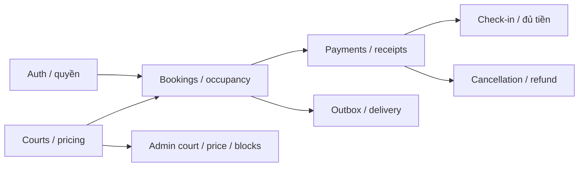

# Miền phát triển và dependency

Tài liệu định vị các vùng đang phát triển và ownership khi chia công việc. Không phải kế hoạch triển khai đã duyệt, bằng chứng PASS hoặc yêu cầu tự tạo worktree. Hiện trạng tổng quát tại [PROJECT.md](PROJECT.md).

## Trạng thái theo miền

| Miền            | Source hiện có                                                                | Khoảng trống cần phân biệt                                             |
| --------------- | ----------------------------------------------------------------------------- | ---------------------------------------------------------------------- |
| Auth/users      | Session, OTP/recovery, CSRF, profile                                          | Refresh rotation/MFA/OAuth chưa có; production topology cần kiểm chứng |
| Courts/bookings | Catalog, pricing, hold/expiry, owner list/detail, cancel, occupancy           | Admin court/price/block chưa đầy đủ                                    |
| Guest/payments  | OTP/proof, intent/recovery, payment request/webhook/receipt, refund/reconcile | Merchant/payout, financial rollout và provider evidence                |
| Check-in        | Token, QR/manual, completion/no-show use cases                                | Browser/staff workflow và worker runtime evidence                      |
| Notifications   | Auth SMTP, payment/outbox jobs                                                | Delivery sink email booking và realtime integration                    |
| Frontend        | Catalog, booking, tickets, auth/account/legal/support                         | Dashboard DEMO, dịch vụ bổ sung thiếu backend, coupon disabled         |

Các miền có implementation không nên tiếp tục được ghi là “chưa implement” toàn bộ. Kiểm thử unit/mock, storage, browser và provider là các mức evidence khác nhau.

## Dependency và ownership

| Vùng              | File/contract trung tâm                        | Điều phối                                                      |
| ----------------- | ---------------------------------------------- | -------------------------------------------------------------- |
| Booking core      | `bookings/`, CourtScheduleReader, BookingStore | Giữ SQL transaction, pricing snapshot và idempotency           |
| Payment/guest     | `payments/`, payment store/DTO, guest recovery | Chốt API/receipts trước UI; không đổi policy bằng mockup       |
| Check-in          | `check-in/`, token/money eligibility           | Consume token và trạng thái trong transaction                  |
| Admin catalog     | `courts/`, schema/PriceRule/occupancy          | Thống nhất invariant trước thêm mutation                       |
| Delivery/realtime | Worker/outbox, notifications                   | Handshake/quyền room/sink ACK cần test riêng                   |
| Frontend          | `frontend/features/`, routes/components        | Dùng contract backend, thể hiện loading/error/conflict/expired |

Một writer mỗi file. Nếu nhiều nhánh đụng schema, AppModule, manifest hoặc API types, chỉ định đầu mối trước khi merge. Không deep-import adapter của miền khác hoặc tự tách database để tránh xung đột Git.

## Điều kiện xác nhận hoàn thành

Thay đổi cần requirement cụ thể, diff có scope và evidence trên revision cuối. Dùng [pipeline](PIPELINES.md) để chọn focused checks. Không tự coi source đã có là provider đã hoạt động; không dùng báo cáo cũ làm test hiện tại. Commit/push/migrate/deploy chỉ trong quyền được giao.
