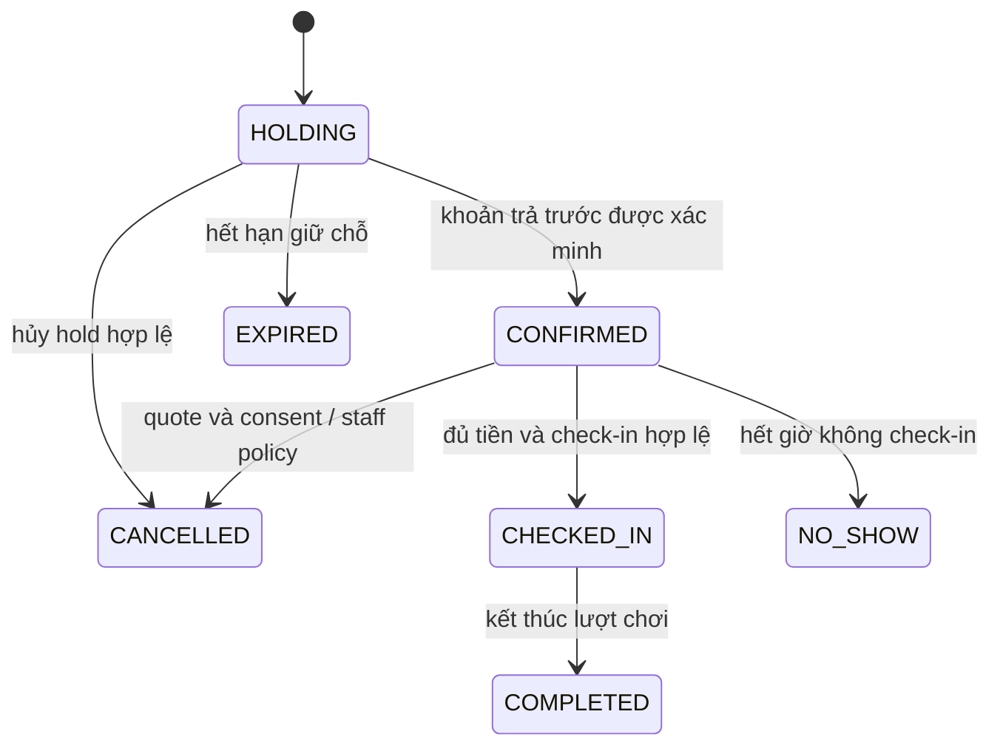

# Quy trình nghiệp vụ và trạng thái

Trang này mô tả hành vi có trong source hiện hành; không chứng minh provider/DB production đã được nghiệm thu. Contract HTTP tại [API.md](API.md), lõi giữ chỗ tại [BOOKING-MVP.md](BOOKING-MVP.md).

## Đặt sân và giữ lịch

1. Client chọn sân ACTIVE, khoảng chơi và lấy availability/giá từ server.
2. Member có phiên hoặc guest xác minh email OTP gửi yêu cầu hold với idempotency key.
3. Server chốt giá, policy và cleanup snapshot; tạo booking HOLDING, occupancy và history trong transaction.
4. Hạn giữ 5 phút theo giờ server. Booking mới cọc 30% cho cả member/guest; không sửa snapshot 100% của lịch sử.
5. Receipt được xác minh và phân bổ hợp lệ mới có thể làm booking CONFIRMED. UI hoặc việc tạo QR/payment link không đủ để xác nhận tiền.

Khoảng chơi linh hoạt theo phút, có timezone. Cleanup tối thiểu 15 phút cộng sau giờ kết thúc, không tính tiền. PostgreSQL exclusion constraint bảo vệ occupancy ACTIVE; Redis lock không thay invariant DB.

Sơ đồ là mô hình chuyển trạng thái; từng transition còn có guard, transaction và điều kiện theo use case. Sự tồn tại của transition không đồng nghĩa browser/provider flow đã được test.

**Ranh giới policy còn lệch:** bảng/transition phía trên mô tả source hiện tại. Tại đúng T−12h, `isInLateCancelWindow` đang dùng `>=` và xếp hủy muộn; [policy đã ghi nhận](LEGAL-AND-PRIVACY.md#chính-sách-booking-đã-duyệt) cho phép hủy thường tại mốc này. Cần sửa và kiểm chứng trong task nghiệp vụ trước release; tài liệu không tự thay policy bằng hành vi code.

## Expiry và tiền đến muộn

Availability chỉ đọc, coi hold quá hạn là không chặn lịch. Worker và write path đối soát expiry để cập nhật trạng thái/release/history. Không tự khôi phục EXPIRED/CANCELLED khi tiền đến muộn; lưu receipt/evidence và xử lý đối soát/nghĩa vụ hoàn theo trạng thái tiền thực tế.

DB commit không atomic với provider hoặc queue. Inbox, idempotency, outbox và job recovery giảm rủi ro lặp/mất bước; không suy an toàn tuyệt đối từ tên worker. Timeout/UNKNOWN không phải căn cứ gửi tiền lại.

## Hủy và hoàn tiền

| Trường hợp                                | Hành vi                                                                                     |
| ----------------------------------------- | ------------------------------------------------------------------------------------------- |
| Hold chưa thanh toán                      | Endpoint cancel-hold riêng, kiểm owner/thời gian/trạng thái; không áp phí paid cancellation |
| CONFIRMED trước cửa sổ hủy muộn           | Báo phí 10% tổng giá, quote có hạn và explicit consent trước apply                          |
| Từ 12 giờ trước startsAt đến trước endsAt | Chỉ staff hủy theo late-cancel; giữ deposit 30%, không cộng phí 10%                         |
| NO_SHOW                                   | Giữ deposit 30%; tiền verified vượt deposit tạo nghĩa vụ hoàn                               |
| Đã có refund request                      | REQUESTED/APPROVED không đồng nghĩa tiền đã trả; cần settlement/evidence phù hợp            |

Ví dụ tổng 1.000.000 VND, đã trả 300.000: hủy thường hợp lệ giữ phí 100.000, tạo nghĩa vụ hoàn 200.000. Hủy muộn/no-show giữ 300.000; nếu lịch sử đã trả 1.000.000, phần vượt deposit là 700.000. Số tiền thực hoàn không vượt tiền verified sau phân bổ/đã hoàn, theo snapshot và transaction.

Không diễn giải câu “mất cọc” thành mất toàn bộ tiền với booking lịch sử trả 100%. Đích hoàn, payout mode, SLA/phí và ngoại lệ merchant/reschedule cần quyết định vận hành riêng; tài liệu không tự duyệt các policy còn mở.

## Check-in và kết thúc

Owner/member hoặc guest đủ quyền xin token CHECKIN. Nhân viên STAFF/MANAGER/ADMIN xác minh QR hoặc check-in thủ công có note theo API. Token gắn booking/purpose/expiry; DB giữ hash, consume/check-in/history/outbox điều phối trong transaction.

Server từ chối booking không CONFIRMED hoặc còn balanceDue theo receipts verified. Cửa sổ mặc định từ startsAt đến trước endsAt; config không hợp lệ phải fail closed. Replay được nhận diện, không tạo thêm check-in. Settlement có use case COMPLETED/NO_SHOW và scheduler; cần kiểm chứng worker trong môi trường đích.

## Guest và thông báo

Guest không có tài khoản giả, dùng contact + email OTP/proof, checkout intent và token gắn booking. Manage token không phải token check-in; không đặt vào query URL hoặc log. Recovery phải dùng proof/token đúng contract, không chỉ mã booking hay số điện thoại.

Auth SMTP có luồng gửi OTP/reset. Worker payment/outbox có retry/quarantine; delivery sink email booking chưa hoàn thiện. Socket.IO chưa được AppModule nạp, availability hiện polling HTTP. Không công bố email booking/realtime là đã hoạt động chỉ vì có model hoặc dependency.

## Nguồn đối chiếu

[Booking use cases](../backend/src/modules/bookings/application/), [payment use cases](../backend/src/modules/payments/application/), [check-in use cases](../backend/src/modules/check-in/application/), [schema](../backend/prisma/schema.prisma), [phạm vi sản phẩm](PROJECT.md), [bảo mật](SECURITY.md). Thiết kế v1 trong data dictionary phải được đọc cùng policy/migration sau này.
