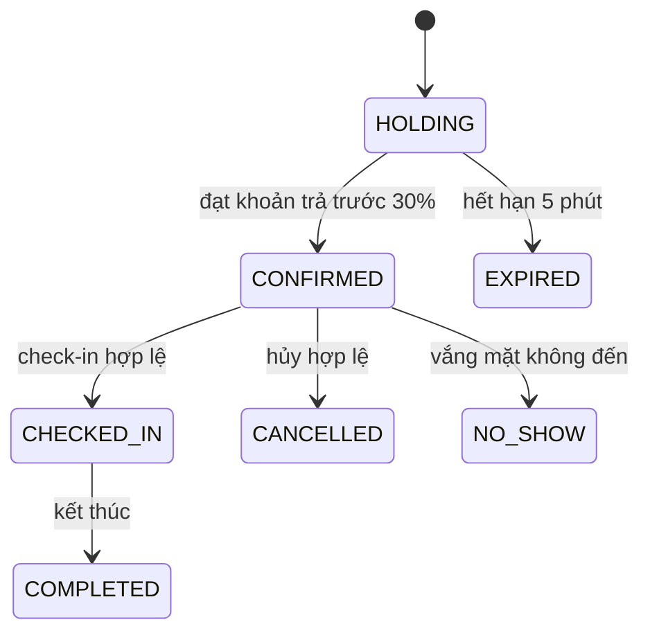

# Quy trình nghiệp vụ và state machine

Booking MVP đã triển khai HOLDING 5 phút, expiry qua BullMQ worker kèm self-heal ở write path và hủy giữ chỗ chưa thanh toán theo owner, trước giờ bắt đầu và chưa check-in. Giá làm tròn từng dòng đến 1 VND rồi cộng tổng. Chi tiết tại [BOOKING-MVP.md](BOOKING-MVP.md). Payment/refund/check-in/guest và CONFIRMED vẫn là thiết kế; sơ đồ dưới đây không chứng minh các luồng đó đã được thực thi.

## Đặt sân và giữ lịch

Thiết kế hiện ghi nhận:

1. Booking lưu sân, thời gian bắt đầu/kết thúc, giá và thông tin khách dạng snapshot.
2. Cả hội viên và khách vãng lai đều áp dụng mức cọc bắt buộc 30% tiền thuê sân (`prepaymentPercent = 30`). Khách vãng lai không tạo user giả, xác thực qua email OTP 6 số và nhận token `MANAGE_BOOKING`.
3. Booking mới ở `HOLDING` với hạn hoàn tất khoản trả trước 5 phút (300 giây). Khi đạt điều kiện thanh toán, luồng chuyển trạng thái booking sang `CONFIRMED`.
4. `CourtOccupancy` đại diện khoảng chiếm lịch; snapshot `cleanupMinutes` mặc định 15 phút được cộng vào cuối giờ chơi. SQL exclusion constraint bảo vệ overlap của occupancy `ACTIVE`.

Khi hủy hoặc hết hạn, thiết kế yêu cầu occupancy được giải phóng; khoản đến muộn phải vào đối soát, không tự khôi phục booking đã `EXPIRED`/`CANCELLED`.

## Hủy và hoàn tiền

Chính sách hoàn hủy chính thức chốt ngày 26/10/2026:
- **Hủy trước 12 giờ so với giờ chơi (`T - 12h`)**: Khách hàng chịu phí hủy 10% tổng giá thuê sân, hệ thống hoàn lại 20% (trong khoản cọc 30% đã thu).
- **Hủy trong vòng 12 giờ hoặc vắng mặt (No-show)**: Không hoàn tiền, khách mất toàn bộ khoản đặt cọc 30%.
- `BookingCancellationRequest` theo dõi quote/consent, còn `RefundRequest` và `RefundAttempt` theo dõi nghĩa vụ và từng lần hoàn. Booking `CANCELLED` không đồng nghĩa tiền đã hoàn.

MVP chỉ hủy HOLDING trước giờ bắt đầu, chưa check-in và không thu phí vì chưa thu tiền. Luồng hoàn tiền tự động qua cổng thanh toán thuộc stream thanh toán tiếp theo.

## Thanh toán và check-in

Schema hỗ trợ nhiều `PaymentRequest` cho booking, receipt `PaymentTransaction`, sự kiện webhook và các refund attempt có idempotency. Luồng provider/webhook/đối soát chưa được implement. Check-in có thể qua QR hoặc thao tác thủ công trong enum; module chưa có endpoint/workflow. Điều kiện trả đủ trước check-in được ghi là đề xuất cần chốt trong [DATABASE-DESIGN.md](DATABASE-DESIGN.md), không phải contract đã hoàn tất.

## Ranh giới an toàn khi implement

- Server xác định giá, thời gian, trạng thái, quyền và kết quả thanh toán.
- Transaction phải bảo vệ invariant DB; Redis chỉ là lớp bổ sung.
- Webhook phải xác minh signature/amount, chống duplicate và xử lý late payment; refund cần idempotency và đối soát trạng thái UNKNOWN.
- Token check-in/manage booking phải gắn đúng booking, có mục đích/expiry và không được dùng lại sau consume nếu contract yêu cầu một lần.
- Ghi lịch sử/outbox cùng transaction nguồn khi nghiệp vụ được triển khai.

Schema và constraint: [DATABASE.md](DATABASE.md). Quyền và token: [SECURITY.md](SECURITY.md). Điểm còn mở có danh sách chuẩn tại [PROJECT.md](PROJECT.md) và [DATABASE-DESIGN.md](DATABASE-DESIGN.md).
