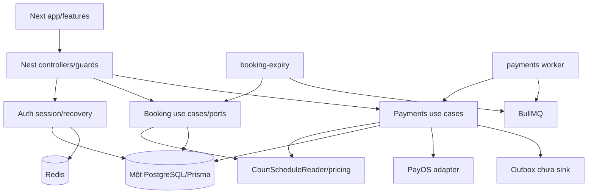

# Pickleball Booking — Codebase Audit tại HEAD

COMP-V2 • 2026-10-23 • HEAD **b9024fae5063e56e5396aa915ddf775bf78ea36f** (“fix(deps): upgrade Next.js to patched 16.4.2”). git ls-remote origin HEAD refs/heads/main trả cùng SHA.

Quyền: ANALYZE + PLAN + DOCUMENT; không implement/migrate/commit/push/deploy. Giữ dirty baseline có sẵn: backend/prisma.config.ts bỏ một comment; frontend/next-env.d.ts đổi import type sinh .next/dev/types sang .next/types. Source nghiệp vụ khớp HEAD; checks dùng working tree/dependencies đã cài, không clean checkout.

Liên quan: [Plan](COMPLETION-PLAN-v2.0.md), [Decisions](DECISION-LOG.md), [Acceptance](ACCEPTANCE-MATRIX.md).

## Kết luận

**Chưa Feature Complete, chưa Integration Tested toàn vòng đời, chưa Deployment Ready.** Auth/booking HOLDING có implementation đáng giữ. Payments **không rỗng**: AppModule nạp use cases/controllers/PayOS adapter/inbox/workers/refund components. Mismatch HTTP–DB và điều phối tiền chặn nghiệm thu. Check-in/realtime chỉ scaffold. Critical path: baseline → payment/guest và expiry → cancellation/refund → check-in/balance → Staff/Admin → notifications/realtime/UI → E2E/security/release/restore; tests đi cùng từng lát.

## Phương pháp

IMPLEMENTED=có execution path; PARTIALLY IMPLEMENTED=có lát nhưng thiếu integration/hành vi; VERIFIED=check mới trong môi trường/phạm vi rõ; MISSING=không handler/wiring trong inventory; DEFECTIVE=mâu thuẫn source/constraint/contract; BLOCKED=thiếu input thực; DOCUMENTATION STALE=docs khác HEAD. Findings tĩnh không được gọi là live exploit hoặc sự cố tiền đã tái hiện.

Đã đọc trực tiếp toàn bộ tài liệu bắt buộc trong prompt: README, docs/README, ARCHITECTURE, BACKEND-ARCHITECTURE, FRONTEND-ARCHITECTURE, WORKFLOWS, BOOKING-MVP, ROADMAP-WORKTREE-STREAMS, DATABASE-DESIGN, DATABASE, SECURITY, PROJECT, OPERATIONS, PIPELINES; thêm FRONTEND-UI. Đã đối chiếu schema/cả6 migrations, modules/infrastructure, frontend app/components/features/services/hooks/context/types, package/config/CI/Compose/seed, unit/integration/E2E tests. Kiểm kê tracked paths và design assets local. Không đọc .env/credential hoặc dùng generated source làm kiến trúc. Audit theo lifecycle/dependency, không chứng nhận semantic review từng dòng CSS/asset/pentest lịch sử.

## Baseline kiểm chứng mới

Codex CLI **0.163.0**, model runtime **unknown**; Node v24.17.0/npm11.13.0/Windows PowerShell. Không install/tạo DB/container/gọi thu chi.

| ID  | Command/check                                                                                                                                     | Kết quả và giới hạn                                                                                                        |
| --- | ------------------------------------------------------------------------------------------------------------------------------------------------- | -------------------------------------------------------------------------------------------------------------------------- |
| V01 | git rev-parse HEAD; status --short; diff hai file; ls-remote origin HEAD refs/heads/main                                                          | PASS snapshot/dirty baseline, không fetch/reset                                                                            |
| V02 | npm run test:backend                                                                                                                              | PASS33 suites/341 tests; 1 suite/4 tests SKIP;73.367s. Unit config loại integration; mock fault logs không là live-storage |
| V03 | npm run test:frontend                                                                                                                             | PASS17 suites/195 tests;45.179s. JSDOM/fetch mocks                                                                         |
| V04 | npm run lint                                                                                                                                      | PASS; no-explicit-any vẫn off, không chứng minh mọi Clean Code rule                                                        |
| V05 | npm run test:auth:contract                                                                                                                        | PASS backend HTTP28/frontend83; DB/Redis mocks. Frontend83 trùng một phần V03                                              |
| V06 | node tools/security-source-check.mjs                                                                                                              | PASS415 files/0 findings; pattern scanner giới hạn                                                                         |
| V07 | tsc --project backend/tsconfig.build.json --noEmit --incremental false; tương tự frontend/tsconfig.json bằng node node_modules/typescript/bin/tsc | PASS cả hai; generated client/types sẵn có, chưa fresh build                                                               |
| V08 | npm audit --json                                                                                                                                  | PASS0 advisory registry trả;939 dependencies metadata; snapshot, không chứng nhận security                                 |
| V09 | npm run test:auth:security                                                                                                                        | PASS1 suite/31 tests;32.545s; HTTP với storage/mail mocks                                                                  |
| V10 | Schema/migration/route/design inspection                                                                                                          | PASS inspection; không chứng minh apply DB/rendered app                                                                    |
| V11 | Fresh install/build, PostgreSQL/Redis thật, provider test, browser E2E/a11y, CI remote/deploy/restore                                             | NOT_RUN; chưa test environment được cấu hình/chỉ định cho audit; merchant/design chưa xác minh; không dùng .env ứng dụng   |

Không đo line/branch coverage; Jest chưa coverage threshold. Không tính evidence lịch sử coordination như check mới.

## Dependency và kiến trúc

Evidence: [AppModule](../../backend/src/app.module.ts), [PaymentsModule](../../backend/src/modules/payments/payments.module.ts), [BookingExpiryModule](../../backend/src/modules/bookings/booking-expiry.module.ts), [QueueModule](../../backend/src/infrastructure/queue/queue.module.ts). CheckInModule nạp nhưng rỗng; RealtimeModule không nạp.

Booking đã use case/port/adapter/presenter, pricing policy thuần. Coupling còn Prisma TransactionContext xuyên ports, Nest DI trong application, CourtScheduleReader lộ persistence shape. Payments application import PrismaService/PayOS adapter/ConfigService/HTTP exceptions; PaymentOutcomeService gom reads, RefundOrchestration gom quote/prepare/complete. GuestBookingForm/StaffOpsPanel giữ state và gọi service trong component. Chuyển từng boundary có regression, giữ transaction/API; không rewrite/generic repository/base use case.

## Audit 14 miền

Các đường dẫn viết ngắn trong bảng tính từ repository root; tên class/function là locator chính xác. Findings phía sau cung cấp liên kết nguồn chi tiết.

| Miền                                          | Execution evidence                                                                                                                                                                         | Trạng thái / test / dependency                                                                                                                                                                                                                                                                                                            |
| --------------------------------------------- | ------------------------------------------------------------------------------------------------------------------------------------------------------------------------------------------ | ----------------------------------------------------------------------------------------------------------------------------------------------------------------------------------------------------------------------------------------------------------------------------------------------------------------------------------------- |
| 1 Auth/session/roles/recovery/profile         | modules/auth: AuthController; AuthService.login/register/getMe/logout; AuthSessionService.authenticate/revoke; JwtStrategy; AuthRecoveryService.resetPassword; EmailOtpService; RolesGuard | IMPLEMENTED JWT15m/current DB roles/version/Redis revoke/CSRF/OTP/recovery; VERIFIED V02/V05/V09 mock. RefreshToken schema không refresh endpoint: giữ contract không refresh. modules/users UserController/UserService scaffold; frontend/components/account/AccountProfileView read-only, edit MISSING; production SMTP/storage NOT_RUN |
| 2 Catalog/availability/PriceRule/hours/blocks | CourtsController.getCourts/detail; QuoteAvailabilityUseCase; court-pricing.ts quoteCourt/applicableRules; PrismaCourtScheduleReader                                                        | IMPLEMENTED public reads/price minute-flexible/buffer; unit V02 PASS. PG suite tồn tại NOT_RUN. Admin CRUD/hours/prices/BLOCK API/UI MISSING                                                                                                                                                                                              |
| 3 Member HOLDING/expiry/overlap/cancel        | CreateHoldUseCase; CancelHoldUseCase; PrismaBookingStore; BookingExpiryProcessor                                                                                                           | IMPLEMENTED300s/snapshot/scoped replay/atomic history+occupancy/exclusion. Unit VERIFIED; PG test tồn tại. Paid lifecycle PARTIAL/DEFECTIVE F07/F08                                                                                                                                                                                       |
| 4 Member30%/100%                              | CreateBookingDto.prepaymentPercent; CreateHoldUseCase.insert/replay; CreatePaymentRequestUseCase                                                                                           | Backend snapshot30/100/default100 có; PG30% test tồn tại. UI BookingInput không percent, PrepaymentSelector chưa mount, checkout100; PARTIAL F01/F02/F05/F17                                                                                                                                                                              |
| 5 Guest                                       | GuestCreateHoldUseCase userId NULL/hash token; GuestBookingsController; GuestTokenService/Guard; GuestBookingForm                                                                          | PARTIAL/DEFECTIVE F03/F11. Không fake user; phone chỉ Length, thiếu normalize/consent; chưa checkout/detail/cancel journey. Token unit PASS/live NOT_RUN                                                                                                                                                                                  |
| 6 PayOS/inbox/receipt/reconcile/confirm       | PayosGatewayAdapter; PayosSignatureService.verifyEnvelope; PayosWebhookInbox.ingest/claim/finalize; VerifyReceiptUseCase; BookingConfirmationCoordinator; StaffReconcileUseCase            | Components IMPLEMENTED, workflow PARTIAL/DEFECTIVE F01–F10. SDK verify có, merchant chưa xác minh. CAS/history/outbox có; allocation/confirm tách tx. Full PG/provider NOT_RUN                                                                                                                                                            |
| 7 Partial/duplicate/late/retry/races          | money.ts; VerifyReceiptUseCase; hai expiry paths; PaymentsWorker.webhookRetry/terminalWatch                                                                                                | DEFECTIVE F06–F10/F14. Whole-receipt allocation có code chưa là approved policy. Không revive qua coordinator nhưng late ALLOCATED thiếu obligation. Unique DB không thay conflict recovery                                                                                                                                               |
| 8 Cancel CONFIRMED/quote/consent/10%          | RefundOrchestration.quoteForCancellation; BookingCancellationRequest schema; UI CancelHold                                                                                                 | PARTIAL quote; MISSING persist/apply/consent/CONFIRMED cancel. F12 thiếu ownership/aggregate fee/reserve/completed accounting. Cutoff/rounding OPEN                                                                                                                                                                                       |
| 9 Staff refund/execution/tracker/audit        | StaffRefundsController/UseCase; RefundOrchestration.prepare/complete; RefundDestinationCrypto AES-GCM; PaymentAuditLogger                                                                  | PARTIAL/DEFECTIVE F13–F15. Four-eyes/UNKNOWN có; payout OFF. Last4 vi phạm SQL, prepare thay destination, complete chưa chứng minh chi. Execution/SLA/merchant BLOCKED                                                                                                                                                                    |
| 10 QR/manual check-in/completion              | CheckInModule @Module({}); entities aliases; BookingCheckin/CHECKIN enums                                                                                                                  | MISSING mint/verify/consume/manual/full-balance/completion, scaffold-only. Ticket chưa QR. Window/no-show OPEN; prompt hiện tại yêu cầu đủ tiền                                                                                                                                                                                           |
| 11 Staff/Admin                                | StaffLookup/Payments/refund controllers + guards; StaffBalance/Allocate; dashboard                                                                                                         | API tiền PARTIAL; staff/admin route tree/timeline/counter create/catalog management MISSING. StaffOpsPanel chưa mount; dashboard DEMO. F14/role-policy OPEN                                                                                                                                                                               |
| 12 Notifications/outbox/realtime              | AuthMailService SMTP; PaymentsWorker.outboxDispatch; RealtimeGateway decorator/class                                                                                                       | Auth mail IMPLEMENTED; booking mail MISSING; outbox PARTIAL/no sink/quarantine F16. Realtime scaffold chưa auth/rooms/handlers/emits, không nạp                                                                                                                                                                                           |
| 13 All UI/responsive/a11y/Figma               | app /, /booking, /courts/[courtId], /bookings, /account/_, /auth/_; ArenaShell/useLiveBooking/useBookingCheckout/history                                                                   | HOLDING UI IMPLEMENTED/JSDOM VERIFIED V03; payment/guest/staff/admin PARTIAL/MISSING F05/F11/F17/F18. Browser/a11y NOT_RUN, approved Figma BLOCKED D10                                                                                                                                                                                    |
| 14 Observability/CI/env/deploy/restore        | ci.yml/scripts/Compose/PrismaService shutdown/auth config/headers                                                                                                                          | Local/CI PARTIAL; V04/V06/V07/V08 đạt. Production packaging/readiness/metrics/CD/restore MISSING. CI thiếu payment/browser/OTP-specific Redis suite; app.e2e contract cũ F19/F20                                                                                                                                                          |

## Findings: exact code và tác động

P0=chặn tính đúng/an toàn tiền hoặc nền kiểm chứng trước bật thu; P1=chặn feature/release. Findings là **đối chiếu tĩnh**, chưa là live transaction/exploit reproduction.

| ID     | Evidence file/symbol                                                                                                                                                                                                                                                                                                                                                                                           | Kết luận và test cần có                                                                                                                                                                                                                                                                                                                                                               |
| ------ | -------------------------------------------------------------------------------------------------------------------------------------------------------------------------------------------------------------------------------------------------------------------------------------------------------------------------------------------------------------------------------------------------------------- | ------------------------------------------------------------------------------------------------------------------------------------------------------------------------------------------------------------------------------------------------------------------------------------------------------------------------------------------------------------------------------------- |
| F01 P0 | [CreatePaymentRequestUseCase.bindKey](../../backend/src/modules/payments/application/create-payment-request.use-case.ts) L261; [PaymentRequest.idempotencyKey](../../backend/prisma/schema.prisma) L745/v1 VARCHAR100                                                                                                                                                                                          | UUID36+booking36+PREPAYMENT10+PAYOS_TRANSFER14+percent3+client min16+5 separators=120>100. UI key dài hơn. Bind thêm method/percent/purpose khiến đổi intent thành key khác, không mismatch guard. Cần compact scoped identity/payload fingerprint + PG length/replay tests                                                                                                           |
| F02 P0 | Cùng file createInTransaction L177–257: readBookingMoney không owner, void subject L192; [RefundOrchestration.quoteForCancellation](../../backend/src/modules/payments/application/refund-orchestration.ts) bỏ actor/cancellationRequestId                                                                                                                                                                     | JWT/CSRF không thay ownership. Sau sửa blocker khác, create/quote có thể dùng ID người khác. Không enforce guest100/snapshot percent/purpose/status/method matrix trong create. Cần owner-before-replay/provider HTTP tests                                                                                                                                                           |
| F03 P0 | [GuestCreateBookingDto](../../backend/src/modules/payments/presentation/guest-bookings.controller.ts) L29–40: prepaymentPercent không decorator; [validation options](../../backend/src/constants/validation.constants.ts) forbidNonWhitelisted=true                                                                                                                                                           | Client gửi100 bị validation reject; bỏ field thì use case reject undefined. Dates chỉ IsString, phone chỉ Length, thiếu consent; error schedule có thể map503. Cần production-pipe HTTP validation                                                                                                                                                                                    |
| F04 P0 | [PrismaPaymentStore.insertReceipt](../../backend/src/modules/payments/infrastructure/prisma-payment-store.ts) L209–231 ghi VERIFIED không verifiedAt; v1 payment_transactions_verified_timestamps_check                                                                                                                                                                                                        | PG yêu cầu verified_at/funds_received_at. Webhook/provider path vi phạm CHECK; STAFF còn cần verifiedByUserId. StaffBalance writer có fields riêng, không đánh đồng. Test mỗi writer trên migrated DB                                                                                                                                                                                 |
| F05 P0 | [CreatePaymentRequestUseCase.attachProviderLink/newOrderCode](../../backend/src/modules/payments/application/create-payment-request.use-case.ts) L86–159; [PayosGatewayAdapter.createLink](../../backend/src/modules/payments/infrastructure/payos-gateway.adapter.ts) L54–60; [PaymentsWorker.processClaimedEvent/paymentCodeOf](../../backend/src/modules/payments/application/payments-workers.ts) L137–194 | OrderCode sinh sau commit/chỉ persist sau response: retry CREATING sinh code mới, timeout/crash có thể orphan/multiple links. PAY-+24 dài28 bị slice25, worker lookup nguyên code từ description đã cắt không match. Không match signed orderCode/linkId. Return/cancel /payment/result chưa route. Cần stable provider intent/crash/SDK contracts, không mặc định merchant limit25   |
| F06 P0 | CreatePaymentRequestUseCase expiresAt=now+15m; [VerifyReceiptUseCase.execute](../../backend/src/modules/payments/application/verify-receipt.use-case.ts) L54–72 commit allocation rồi confirm tx khác; duplicate L110 không confirm                                                                                                                                                                            | Crash sau receipt commit trước confirm không tự chữa qua duplicate; deadline có thể expire dù receipt đã commit trước hạn. Comments minTTL/cùng tx khác code. Cần atomic coordinator hoặc durable recovery với DB clock proof; D06 chốt link TTL presentation                                                                                                                         |
| F07 P0 | [PrismaBookingStore.expireEligibleHolds](../../backend/src/modules/bookings/infrastructure/prisma-booking-store.ts) L96 + create/replay/list/cancel/BookingExpiryProcessor; [coordinator.expireHoldWithObligations](../../backend/src/modules/payments/application/booking-confirmation-coordinator.ts)                                                                                                        | Expiry cũ không money lock/obligation/outbox. Nếu cũ đổi EXPIRED trước, coordinator ALREADY_FINAL bỏ credited receipts. CAS chống revive chưa giải quyết tiền bị bỏ. Cần một exit contract, PG races mọi caller                                                                                                                                                                       |
| F08 P0 | VerifyReceiptUseCase.allocateInTransaction L135–157 ALLOCATED trước kiểm status/deadline; [CancelHoldUseCase.assertCancellable](../../backend/src/modules/bookings/application/cancel-hold.use-case.ts); PrismaBookingStore.releaseCancelled                                                                                                                                                                   | Late EXPIRED/CANCELLED vẫn ALLOCATED khi balance còn, sweep chỉ HOLDING nên không obligation. HOLDING nhận một phần vẫn hủy đường chưa thu tiền. Không thấy revive nhưng thấy sai phân loại/nghĩa vụ; D07 và tests                                                                                                                                                                    |
| F09 P0 | [PayosWebhookInbox.ingest](../../backend/src/modules/payments/infrastructure/payos-webhook-inbox.ts) find-then-create; v1 webhook_valid_business_dedup; PrismaPaymentStore.findReceiptByCanonicalIdentity/insertReceipt                                                                                                                                                                                        | Unique DB có nhưng concurrent insert chưa recover duplicate ACK; existing key bỏ payload conflict. Normalize lúc tìm nhưng persist original; CASH không lookup key. Cross-booking locks cần unique-conflict recovery/bind account-channel-reference-currency-amount-order                                                                                                             |
| F10 P1 | PaymentsWorker.terminalWatch linkId not null; StaffReconcileUseCase.execute chỉ diff; PrismaPaymentStore.markRequestPaid chưa receipt caller; [PaymentOutcomeService.buildStatus/bookingDetail](../../backend/src/modules/payments/application/payment-outcome.service.ts)                                                                                                                                     | CREATING mất response/linkId không recovery scanner. Request không tổng hợp PAID/PARTIALLY_PAID. Summary loại REFUND_REQUIRED khỏi credited nhưng trừ refunds mọi receipt: có thể throw refunded>credited. Facts failed/destination false, review reason/snapshot có thể sai                                                                                                          |
| F11 P1 | [GuestTokenGuard](../../backend/src/modules/payments/infrastructure/guest-token.guard.ts) đòi bookingId params/query/body; guest status path chỉ:id; [payment-service.getGuestPaymentOutcome](../../frontend/features/payment/api/payment-service.ts) không bookingId; StaffGuestTokenController.reissue                                                                                                       | Guest helper thiếu binding; guest create payment/detail/cancel routes chưa có. Reissue revoke-loop+issue không atomic/audit actor/reason. Replay không trả raw token là bảo vệ có chủ đích nhưng lost-response recovery chưa đủ; GuestBookingForm sinh key mới mỗi submit                                                                                                             |
| F12 P0 | [RefundOrchestration.quoteForCancellation](../../backend/src/modules/payments/application/refund-orchestration.ts) L54–114: cancellationRefundFor trong receipt map; reservedByReceipt=new Map L77                                                                                                                                                                                                             | Total1m/receipts300k+700k → code200k+600k=800k thay vì900k sau một phí100k. Reserve map không sum, không completed refunds. QuoteId random không persist; revision chuỗi không digest/apply verification. MISSING consent/APPLIED/cancel-confirmed. Cutoff/rounding OPEN                                                                                                              |
| F13 P0 | [StaffRefundsUseCase.approve](../../backend/src/modules/payments/application/staff-refunds.use-case.ts); RefundOrchestration.prepare/complete; v1 refund_requests_bank_destination_check                                                                                                                                                                                                                       | Last4-only thiếu encrypted account bị SQL chặn APPROVED bank refund. Prepare thay bank/name/last4 sau approve nhưng full encrypted account cũ. Complete chỉ length/reference, không reconcile amount/destination/chung reserve lock. Cần immutable destination và reserve tổng≤receipt, không chỉ nới CHECK                                                                           |
| F14 P0 | [StaffAllocateUseCase.execute](../../backend/src/modules/payments/application/staff-allocate.use-case.ts) đọc receipt/refund trước lock L32–72 rồi update không CAS; [StaffBalanceUseCase.execute](../../backend/src/modules/payments/application/staff-balance.use-case.ts) replay global key                                                                                                                 | Facts stale sau chờ lock; allocate key không dùng. Balance key booking khác replay resource khác; prefix staff-balance:+max100 vượt receipt VARCHAR100. Approve/reject keys chưa replay. Cần concurrent intent mismatch/refund-allocation tests                                                                                                                                       |
| F15 P1 | [StaffRefundsController](../../backend/src/modules/payments/presentation/staff-refunds.controller.ts) approve/reject STAFF/MANAGER/ADMIN; StaffPaymentsController reconcile STAFF; PaymentAuditLogger; approve DENIED audit rồi throw trong tx                                                                                                                                                                 | Quyền cuối OPEN D08, không khẳng định STAFF đã bị cấm theo policy. approvalSource MANAGER không chứng minh actor. DENIED audit rollback; prepare/complete/token issue thiếu audit. Append-only chỉ convention, chưa DB grants/retention; nhiều caller không truyền IP                                                                                                                 |
| F16 P1 | [PaymentsWorker.outboxDispatch](../../backend/src/modules/payments/application/payments-workers.ts) L283–314                                                                                                                                                                                                                                                                                                   | Không sink/không publish giả là điểm giữ. Quarantine nextRetryAt=null lại được query chọn, oldest poison rows chiếm batch100 mãi. Chưa lease/fencing/sink ACK/NotificationDelivery producer/booking email worker                                                                                                                                                                      |
| F17 P1 | [use-payment-status.ts](../../frontend/features/payment/hooks/use-payment-status.ts) createCheckout100; usePaymentStatus closure requestId/status; [booking-request-intent](../../frontend/features/booking/hooks/booking-request-intent.ts) không percent; payment-service chỉ nested error.code                                                                                                              | 30% chưa nối; reopen POST trước recovery read. Poller cũ chưa dùng journey có stale/unmount risk, comment không evidence. Backend top-level code/HTTP200 successfalse khác parser; CSRF retry có thể không nhận diện. Staff approve client gửi destination nested, DTO phẳng. Cần producer-consumer tests                                                                             |
| F18 P1 | [booking-service.ts](../../frontend/features/booking/api/booking-service.ts) loadServiceProducts/checkAvailability; controllers inventory; GuestBookingForm/StaffOpsPanel/PrepaymentSelector chỉ export/tests                                                                                                                                                                                                  | GET court services/POST court quote thiếu backend và service snapshot schema. Không chọn services còn API cũ. D14 chốt scope trước commerce migration. Guest/staff/percent components chưa route journey. Dashboard DEMO nhưng badge thời gian thực dễ gây hiểu nhầm                                                                                                                  |
| F19 P0 | [payments-coordinator.integration.spec.ts](../../backend/test/payments-coordinator.integration.spec.ts) fixtures/makeBooking/makeReceipt/beforeEach; [CI](../../.github/workflows/ci.yml); [app.e2e-spec.ts](../../backend/test/app.e2e-spec.ts) contract cũ                                                                                                                                                   | Payment suite không npm/CI/require-storage guard. userA/B không insert nhưng FK; VERIFIED thiếu verifiedAt; CANCELLED thiếu cancelledAt; userId:null bị ??userA; hai ACTIVE bookings trùng giờ; expired token expiry<createdAt; cleanup deleteMany toàn DB test. Tồn tại chưa là PG pass. app.e2e còn verify{token}/response keys trước OTP. Không chạy destructive suite trong audit |
| F20 P1 | AppModule tạo Observe factory không import ObserveModule; AppController HelloWorld; QueueModule/RedisService/.env.example; Compose/CI/scripts                                                                                                                                                                                                                                                                  | Chưa readiness DB/Redis/workers/migrations/metrics. BullMQ host/port/password tách REDIS_URL, chưa TLS parity. PayOS config truthy coi placeholder configured; creation switch consttrue. Chưa production images/proxy/CD/restore/bootstrap admin prod. nest deploy/local Compose không deploy evidence                                                                               |

## Schema/migration health

[schema.prisma](../../backend/prisma/schema.prisma) hiện **23 models**, gồm PaymentAuditLog sau baseline22 trong docs. Đã đọc6 migrations:

| Migration                                    | Nội dung / điều kiện giữ                                                                                                                                               |
| -------------------------------------------- | ---------------------------------------------------------------------------------------------------------------------------------------------------------------------- |
| 20261009000100_v1_initial                    | btree_gist/enums/FKs/CHECK/partial uniques/triggers; court_occupancies_no_active_overlap bảo vệ ACTIVE [from,until) cho BOOKING/BLOCK; composite FK court/branch/token |
| 20261013082736_updated_user_optional_v2_edit | username/email SET NOT NULL; preflight existing NULL, không tin tên migration                                                                                          |
| 20261013090000_normalize_auth_phone          | Lock users, invalid/collision preflight, timeout5s/30s; rollback sau commit cần backup theo ID                                                                         |
| 20261016090000_booking_user_idempotency      | Unique user+key/partial guest; rollback global key có thể xung đột cross-user duplicates                                                                               |
| 20261021000000_payments_m03_metadata         | Nullable QR/account-name/BIN additive; rollback app giữ metadata                                                                                                       |
| 20261022000000_payments_audit_log            | Table/index audit; chưa DB privileges cưỡng chế append-only                                                                                                            |

NOT_RUN fresh/upgrade migration/drift/extension permission/EXPLAIN/DB đích/restore. Không sửa migration đã apply. NUMERIC(14,0) khác MAX_VND_AMOUNT12 digits: D05 chốt rate/total/rounding/range. SQL không bảo đảm price lines phủ/sum total hoặc sum refunds≤receipt; transactional writers phải kiểm. Dùng CourtOccupancy/BookingAccessToken/NotificationDelivery, không tạo model cũ CourtBlock/BookingToken/NotificationLog theo roadmap stale.

## Thiết kế/frontend thực có

Đã inspect [Figma generator](../../tools/figma-designer/code.js) và manifest5 screens. Comment replicates100% không approval evidence. Đã xem ảnh local .temp/court-blueprint-desktop.png, định vị .temp/standalone-court-blueprint.html và .temp/task-015/before/pickleball-booking-detail.html. Đây là blueprint/demo lịch sử, không screenshot app HEAD. Ảnh sáng/hourly presets/coupon/demo money khác Arena dark glass hiện mô tả; không lấy policy/grid mẫu ghi đè invariants.

Inventory được kiểm tra chưa có .fig/.figma hoặc Figma URL/node/version đã owner xác nhận; tool inventory phiên không Figma connector. Approved fidelity BLOCKED D10; browser responsive/keyboard/screen reader/contrast NOT_RUN. [FRONTEND-UI](../FRONTEND-UI.md) mô tả HTML user cung cấp chỉ định hướng.

## Documentation stale

| Claim cũ                                                                                                            | Evidence mới                                      | Việc cần làm                                         |
| ------------------------------------------------------------------------------------------------------------------- | ------------------------------------------------- | ---------------------------------------------------- |
| README/WORKFLOWS/BOOKING-MVP/PROJECT/BACKEND-ARCHITECTURE/CODEBASE-MAP/SECURITY/OPERATIONS nói payment rỗng/chưa có | PaymentsModule/use cases/adapters/workers/refunds | C25 ghi partial + defects, không đổi thành complete  |
| DATABASE/DATABASE-DESIGN22 models/user nullable/chưa CLI/build/test                                                 | Schema23/migrations sau v1/V02/V07                | Tách lịch sử authored với source và DB đích          |
| ARCHITECTURE service-centric/chỉ expiry worker                                                                      | Booking ports/Payments workers                    | C22/C25 cập nhật dependency/coupling                 |
| ROADMAP missing Payments toàn bộ/model names cũ/check-in-refund song song hoàn toàn                                 | Code thực và shared money/status transactions     | Thay dependency DAG/single writer schema             |
| PIPELINES20 moderate2026-10-16                                                                                      | V08 hiện0 advisory                                | Gắn timestamp, không suy0 advisory=security complete |

Chưa sửa legacy docs ngoài4 deliverables; C25 đồng bộ sau implementation/verification.

## Báo cáo vai trò và phần việc thực tế

| Role / skill path                                                                                   | Trách nhiệm → việc thực tế / trạng thái                                                                                                                                            |
| --------------------------------------------------------------------------------------------------- | ---------------------------------------------------------------------------------------------------------------------------------------------------------------------------------- |
| Principal Software Architect / Backend Architect — .agents/skills/agency-backend-architect/SKILL.md | Codex CLI0.163.0/model unknown trực tiếp đọc docs/source/schema/config/tests, audit lifecycle/dependencies/F01–F20, chạy V01–V09, viết4 artifacts/self-check; không implementation |
| Payments Billing Specialist — .agents/skills/agency-payments-billing-engineer/SKILL.md              | Trực tiếp lần request→SDK→inbox→receipt→confirm/expiry/refund, đối chiếu CHECK/idempotency/races/ledger; giữ owner/merchant OPEN; provider/real money NOT_RUN                      |

Independent review là phiên riêng sau snapshot tài liệu, không thay bằng self-check writer. Nguồn provider read-only: [payOS API](https://payos.vn/docs/api/) và [kênh chi](https://payos.vn/dang-ky-dich-vu-chi-ho/). Public API liệt kê production, không suy sandbox/merchant đã sẵn sàng. Cần pin SDK/merchant channel trước triển khai; không gọi thu/chi thật.
