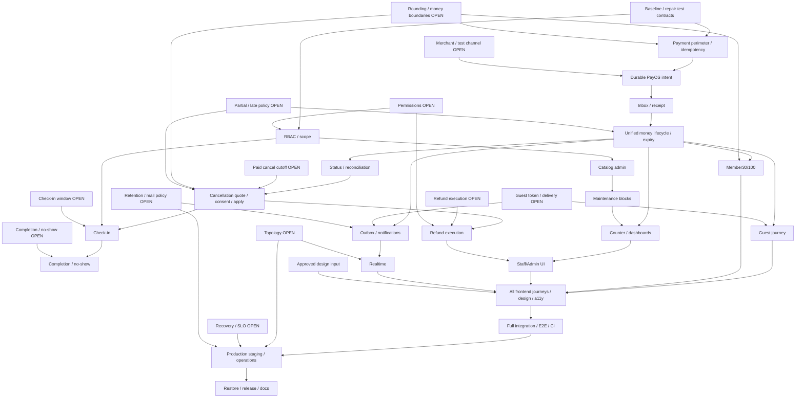

# Completion Plan v2.0 — Pickleball Booking

**COMP-V2 • PLAN ONLY • 2026-10-23 • baseline b9024fae5063e56e5396aa915ddf775bf78ea36f.**

Mục tiêu: hoàn thiện dự án hiện có thành Feature Complete, Integration Tested và Deployment Ready. Đây là kế hoạch thực thi sau review/phê duyệt; không cấp quyền implement, install, migrate DB ứng dụng, charge/refund thật, commit/push hoặc deploy. Dừng sau tài liệu và independent review.

Inputs: [Codebase audit/evidence F01–F20/V01–V11](CODEBASE-AUDIT.md), [Decision log](DECISION-LOG.md), [Acceptance/traceability](ACCEPTANCE-MATRIX.md). Source/SQL/contract ở HEAD có ưu tiên hơn mô tả stale; owner policy OPEN không biến thành approved bằng code/comment/mẫu UI.

## Phân loại backlog

| Nhóm                                                  | Hành động                                                                                                                                                                                                                                                      |
| ----------------------------------------------------- | -------------------------------------------------------------------------------------------------------------------------------------------------------------------------------------------------------------------------------------------------------------- |
| Already working trong phạm vi đã chứng minh: preserve | Auth session/CSRF/current roles/OTP/recovery và trạng thái unknown; public catalog; pricing minute-flexible; member HOLDING300s/snapshot/scoped replay; DB exclusion; UI không fake success/QR. Evidence mock/unit trong audit, chưa gọi full runtime verified |
| Existing but unverified: inspect/test                 | PG/Redis adapters, schema migrations, money workers/coordinator, SDK signature/create response, tokens/refund encryption. Chạy real-storage/SDK contract/provider tests trước nhận complete                                                                    |
| Partial: complete/refactor                            | Payment/guest/cancellation quote/refund/manual ops/outbox/UI checkout/history. Sửa F01–F20 theo dependency, không xây Payments mới                                                                                                                             |
| Missing: implement                                    | CONFIRMED cancellation apply/consent, check-in/completion, admin CRUD/BLOCK/counter create/portals, notification sink, authenticated realtime, deployment/restore                                                                                              |
| Blocked: isolate                                      | Financial decisions D01–D09; approved designs D10; prod topology/SLO D11–D13; services scope D14/contact scope D15; merchant credentials/test channel. Dùng fail-closed feature gates, không giả provider/financial success                                    |

## Invariants phải giữ

Một NestJS modular monolith, Next.js và một PostgreSQL qua Prisma; Redis/BullMQ chỉ làm hạ tầng phù hợp. HOLDING **5 phút**; lịch chính xác đến phút, không bắt grid15phút. Cleanup **ít nhất15phút**, không tính vào tiền chơi. PostgreSQL transaction + exclusion là bảo vệ concurrency cuối; Redis lock không thay thế.

Member30% hoặc100%; guest userId NULL/contact hợp lệ/100%. VND nguyên, rounding deterministic, immutable booking/price/policy snapshots. Phí khách hủy **10% tổng booking, chỉ một lần**, quote và explicit consent. Không revive EXPIRED/CANCELLED bởi late payment. Callback/event externally delivered idempotent. Cancellation, refund obligation và refund succeeded là các financial states riêng. Server authority cho giá/role/balance/status/payment. Check-in yêu cầu đủ balance theo mission; window/no-show vẫn OPEN. Không đổi các giá trị này bằng design prototype hoặc ví dụ agency.

## Kiến trúc mục tiêu từng lát

- Presentation: controllers/HTTP DTO/guards/presenters; map application typed errors ra HTTP consistent. Không truyền Express/provider SDK/ORM rows vào lõi mới.
- Application: một use case cho một hành động; input/result/ports và mục tiêu atomic. Domain: money/price/transition policies thuần khi có nhu cầu thật.
- Infrastructure implement application ports cho Prisma/PayOS/SMTP/Redis/BullMQ. Composition root lắp DI. Transaction port phía application giữ một connection/boundary; không mở tx riêng cho từng bước.
- Thay dần direct Prisma/adapter imports và TransactionContext leakage khi chạm use case; regression bảo vệ public contracts. Không generic repository/base service/CQRS/event bus nếu không có vấn đề cụ thể.
- Booking sở hữu lifecycle/occupancy; Payments sở hữu request/receipt/refund accounting. Coordinator công bố narrow public contracts cho transition + money trong cùng PostgreSQL transaction. Hợp nhất expiry cũ/mới trước thêm workflow paid. Không sửa bảng module khác qua private deep imports.
- Frontend giữ api/model/hooks/presentation/state owner, cùng authoritative DTO; mỗi mutation giữ stable intent/recovery. Không client recompute hoặc tự confirm tiền.
- Owner theo bảng là trách nhiệm module/role đề xuất, không phải worker đã dispatch. Một writer/schema migration; contract-first; chỉ song song khi inputs ổn định. Không tự tạo worktree/branch/team.

## Dependency-driven execution

C12 profile, C21 security và C22 refactor chạy cùng lát liên quan, không chờ cuối mới khóa security/architecture. C26 services conditional sau D14; nếu in-scope thì vào C23 trước feature gate. D01–D15 được giải quyết trước task phụ thuộc; việc độc lập tiếp tục, không đòi một vòng planning khác.

## Task register

S=nhỏ/cohesive; M=nhiều component một boundary; L=xuyên module/transaction/UI; XL=distributed failure/financial lifecycle. Đây là complexity tương đối, không cam kết ngày hoàn thành.

| ID  | Severity       | Depends on                              | Owner module / role đề xuất                | Complexity / current evidence       |
| --- | -------------- | --------------------------------------- | ------------------------------------------ | ----------------------------------- |
| C00 | P0             | —                                       | Test/tooling + Backend/API tester          | M; V01–V11/F19                      |
| C01 | P0             | C00,D05                                 | Payments presentation/application + AppSec | M; F01/F02/F03/F17                  |
| C02 | P0             | C01,D06                                 | Payments PayOS adapter/store               | L; F05/F06/F20                      |
| C03 | P0             | C01,C02                                 | Payments inbox/receipt + DB                | XL; F04/F09                         |
| C04 | P0             | C03,D07                                 | Booking lifecycle coordinator + Payments   | XL; F06/F07/F08                     |
| C05 | P0             | C01,C02,C04,D09                         | Guest boundary Booking/Payments + FE       | L; F03/F11                          |
| C06 | P1             | C01,C02,C04,D05                         | Member Booking/Payments + FE               | M; F17                              |
| C07 | P0             | C02,C03,C04                             | Payments queries/reconciliation            | L; F10                              |
| C08 | P0             | C04,C07,D01,D05,D07                     | Bookings cancellation + Payments           | XL; F12                             |
| C09 | P0             | C04,C08,D04,D08                         | Payments refunds/audit                     | XL; F13/F14/F15                     |
| C10 | P1             | C04,C07,C08,C13,D02                     | Check-in + Booking/Payments                | L; scaffold                         |
| C11 | P1             | C10,D03                                 | Bookings completion/no-show                | M; no workflow                      |
| C12 | P1             | C00,D15                                 | Users/Auth profile + FE                    | M; read-only/scaffold               |
| C13 | P0             | C00,C01,D08                             | Auth authorization + all staff boundaries  | M; guards exist                     |
| C14 | P1             | C13,D05                                 | Courts admin/pricing/hours                 | L; read-only                        |
| C15 | P1             | C04,C13,C14                             | Courts/Booking occupancy                   | M; BLOCK schema only                |
| C16 | P1             | C04,C07,C13,C14,C15                     | Staff counter/booking queries/reports      | L; money APIs partial               |
| C17 | P1             | C09,C10,C11,C13,C14,C15,C16             | Staff/Admin frontend                       | L; unmounted panel/demo             |
| C18 | P1             | C04,C08,C09,C10,D09,D13                 | Outbox/Notifications/SMTP                  | L; F16                              |
| C19 | P1             | C13,C18,D11                             | Notifications realtime + FE sync           | L; scaffold                         |
| C20 | P1             | C05,C06,C08,C10,C11,C12,C17,C18,C19,D10 | Frontend journeys/accessibility            | L; V03/F17/F18                      |
| C21 | P0             | C00,C01,C13,D11,D13                     | AppSec/config/headers/audit                | L; partial controls                 |
| C22 | P2             | C01,C03,C04; follow each affected task  | Architecture owners backend/frontend       | L incremental; coupling audit       |
| C23 | P0             | C05–C22 as applicable,C26 if in-scope   | API/test automation + CI                   | XL; missing full lifecycle evidence |
| C24 | P1             | C21,C23,D11,D12,D13                     | DevOps/observability/config                | L; F20                              |
| C25 | P1             | C24,D04,D08,D12                         | DevOps/data owner/docs/release owner       | L; no restore/deploy proof          |
| C26 | P1 conditional | D14,D05,D07,C04,C14                     | Services/catalog/Booking + FE              | L/XL if approved; F18               |

C23 is a final aggregation gate; focused unit/integration/contract/E2E checks below are acceptance of each task and run earlier, not deferred until C23. C22 acceptance is required for new code; removal of unrelated legacy debt is not a prerequisite to every task.

## Task details

Mỗi task dưới kế thừa invariants và rollback nguyên tắc: additive migrations, không rewrite migration đã apply, không xóa ledger/receipt để chữa lỗi, rollback application không bỏ inbox/outbox/refund obligations. “Schema=none” nghĩa không cần thay schema dự kiến; khi code evidence buộc đổi, phải ghi migration/preflight/test vào task trước implementation. U=unit, I=real-storage integration, C=HTTP/SDK/producer-consumer contract, E=browser/system end-to-end.

### C00 — Baseline tái lập, sửa nền kiểm chứng

- Changes: inventory routes/import graph/migration constraints và baseline ở exact SHA; sửa fixtures/payment suite guards/cleanup và app.e2e OTP contract (F19), thêm scripts test:payments:integration + required-storage CI. Owner tests/config; API/schema không đổi hành vi.
- Transaction/security: chỉ DB/Redis disposable có tên/host allowlist và fixture-owned IDs; không deleteMany toàn DB dùng chung, không provider network ngoài stub.
- Frontend: giữ unit/rendering baseline; không đổi UI.
- Tests U: fixture builders/guards; I: fresh6 migrations + valid FK/CHECK fixtures; C: OTP registration/verify/reset response; E: system startup/teardown smoke, browser deferred C23.
- Acceptance: suite không được skip khi REQUIRE_STORAGE=true, cleanup chỉ fixtures; baseline lint/type/unit/contract recorded, fail/skip phân biệt; migrations được đọc/kiểm constraint ở DB test.
- Regression/rollback: không sửa production để test pass; đổi test setup có thể revert, giữ constraints. Complexity M.

### C01 — Khóa payment perimeter và intent

- Changes: CreatePaymentRequestUseCase/RefundOrchestration authorization-before-replay; sửa GuestCreateBookingDto decorators; chuẩn hóa errors/purpose/method/percent/status DTO matrix. Thay concatenated key bằng bounded scope hash + request fingerprint; same subject/key different intent→409; schema dự kiến additive fingerprint/version nếu cần lưu intent, không tăng VARCHAR tùy tiện.
- Transaction/security: owner/guest binding trước expose/provider; mọi key dài hợp lệ phải vừa DB; không cho customer ghi receipt/mark paid; guest100 và percent snapshot server.
- Frontend: parser nhận canonical HTTP status/top-level code, preserve CSRF-only retry; staff destination DTO thống nhất. Không mount journey trước backend test.
- Tests U: fingerprint/error mapping; I: min/max keys, concurrent same key/mismatch; C: HTTP JWT/CSRF/IDOR/forbid fields; E: unauthorized action không tạo link.
- Acceptance: cross-owner404, bad input400/semantic409/410 theo frozen contract, no provider call on deny; same intent một resource, mismatch zero mutation.
- Regression/rollback: additive envelope rollout tương thích clients cũ trong cửa sổ xác định; rollback vẫn đọc keys cũ, không tạo charge mới. M.

### C02 — Durable PayOS create/recover

- Changes: persist stable unique provider orderCode/intent trước network; leased create/recover scanner, conditional metadata fill; correlate orderCode/linkId thay description truncation. Query provider bằng persisted orderCode nếu linkId mất theo SDK contract đã pin. Bounded deadlines/cancellation/cleanup timers; runtime creation switch fail-closed/config validation. Proposed additive creation lease/state/attempt fields hoặc outbox operation do Payments sở hữu, migration riêng.
- Transaction/security: DB commit intent → provider outside tx → CAS result; unique scope channel/orderCode; không dùng SDK response chưa xác minh; validate amount/currency/account/link ownership. D06 xác nhận channel/TTL/description limits, không charge thật.
- Frontend: /payment/result phục hồi bằng owner/guest read, không trust query status; loading/unknown/CREATING message; countdown hold không hứa15m giữ sân.
- Tests U: state/timeouts; I: unique lease/concurrent create; C: pinned SDK request/create/get/signature fixtures; E: create response lost/reload giữ cùng logical intent.
- Acceptance: crash trước/sau provider/metadata persist vẫn recover về cùng intent; no second orderCode do retry; không orphan không tra được; create-disabled vẫn nhận webhook/read/reconcile.
- Rollback: tắt tạo mới qua server config; giữ old links/inbox/reconciler, không hủy nghĩa vụ. L.

### C03 — Inbox và receipt đúng SQL/idempotency

- Changes: PayosWebhookInbox atomic accept/upsert conflict recovery; persist verified normalized facts, conflict quarantine thay silently drop. PrismaPaymentStore.insertReceipt ghi verifiedAt/fundsReceivedAt/actor đúng CHECK; canonical account+channel+reference dùng cùng khi đọc/ghi, cash scoped intent key. Webhook return4xx signature,5xx durable-storage failure,2xx only after accepted durable commit.
- Transaction/security: validate signed amount integer/VND/channel/account/order/link; global unique receipt conflict handling xuyên booking locks, không dedup amount/order khác như success. Lease/generation fencing + bounded retry/DLQ; schema additive quarantine/normalized identity nếu không diễn đạt đủ trong columns/index hiện có.
- Frontend: hiển thị pending/review server; không dùng redirect kết luận.
- Tests U: normalization/signature/invalid facts; I: CHECK tất cả writers/concurrent webhook-provider-staff duplicates; C: signed fixtures/same reference conflicting amount/account/order; E: provider delivery→one receipt.
- Acceptance: duplicate/retry/crash tạo đúng một money fact; invalid signature zero effects; ack lost/worker crash vẫn drain; conflict có case/audit, không credit thêm.
- Rollback: giữ inbox/receipts và worker compatible event version; không xóa duplicates để “sửa tiền”. XL.

### C04 — Một coordinator cho money/lifecycle/exit

- Changes: Bookings công bố transition contract; Payments contribution kiểm money/reserve trong cùng tx. Route old expiry worker/create/replay/list/cancel và payments sweep qua cùng exit boundary; loại duplicate writer. Allocate+confirm atomic hoặc persist recoverable decision trước release; partial/late/overpay obligations đúng D07, không terminal ALLOCATED mới. Add transactional outbox cho mọi lifecycle change. Schema dự kiến dùng hiện có; chỉ thêm unique obligation/decision key nếu cần constraint thật.
- Transaction/security: consistent order booking-money advisory → booking row FOR UPDATE → receipt/refund/attempt IDs; DB clock sau lock; CAS/version và exclusion giữ nguyên; receipt commit/confirm boundary phải có crash proof; provider/Redis ngoài tx.
- Frontend: reload/replay trả status server, hold timer chỉ refresh; HOLDING có tiền không dùng copy chưa thanh toán.
- Tests U: decision table; I: all expiry/lazy/cancel vs payment permutations, equal-deadline, crash/rollback/outbox; C: stable status/review; E: hai clients tranh sân, pay-vs-expire/cancel.
- Acceptance: no revive; một transition/history/outbox; mọi tiền terminal có classified obligation/case; no confirmed booking released by old worker; expired slot rebook bảo vệ15m buffer.
- Rollback: giữ coordinator tương thích worker cũ hoặc dừng/drain lịch cũ trước rollout; tắt create mới, không re-enable unsafe writer. XL.

### C05 — Guest journey và scoped recovery

- Changes: complete guest create/read/payment create/cancel/refund read via GuestTokenGuard, contact normalize/email/phone validation, explicit policy consent; guest hold dùng cùng aggregate/expiry contract C04. Reissue token revoke+issue atomic có actor/reason/audit, correct token TTL D09; scoped replay/lost response recovery không leak raw token. API routes add /api/guest/bookings/:bookingId/detail/payment-quote và /api/guest/payments/requests (tên frozen trước FE); token status path bind booking ID rõ.
- Transaction/security: userId NULL/100 enforced HTTP+domain+DB; token256bit hash/purpose/booking/expiry/revoke; rate limits shared Redis, no token URL/log/outbox plaintext; không auto-link guest to account.
- Frontend: mount guest entry/form→checkout→secure single-booking management→refund tracker; persist stable intent qua uncertain result; lost token recovery hướng operator.
- Tests U: contacts/token/replay; I: NULL guest constraints/token reissue concurrency; C: every guest route positive/cross-booking/expired/revoked; E: guest không account complete flow và lost response/reload.
- Acceptance: one hold/payment per intent, zero fake users; guest30 rejected; token chỉ đúng booking/purpose; credentials omit path hoạt động và status helper không thiếu binding.
- Rollback: đóng guest create, giữ manage/refund reads và outstanding callbacks/token lookup. L.

### C06 — Member30/100 và checkout recovery

- Changes: BookingInput/model/hook/PrepaymentSelector truyền explicit percent; quote/checkout từ immutable requiredPrepaymentAmount; create request không tự đổi percent của booking. Owner modules Bookings/Payments/FE booking/payment; additive DTO fields, schema none ngoài C01/C02.
- Transaction/security: replay fingerprint gồm percent; server tính tất cả tiền, validate snapshot; authorization vẫn mỗi request.
- Frontend: mount selector trước hold, reload/deep-link dùng latest request/detail trước create; unknown retry giữ key; đủ tiền không tạo zero BALANCE; chuyển account/unmount abort/stale protection.
- Tests U: intent/parser/state; I:30/100 snapshot/replay; C: producer-consumer DTO và error/CSRF; E: member30→confirmed→balance và100→confirmed, reload/error/lost-response.
- Acceptance: total150k/30%=45k required và105k balance được server trả,100%=150k; UI không hardcode phần trăm/giá ngoài option contract; no duplicate link.
- Rollback: 100% legacy path chỉ giữ với contract đã có; không mutate snapshot bookings30 đã tồn tại. M.

### C07 — Money projections, request status và đối soát

- Changes: PaymentOutcomeService/read ports consistent snapshot; paid/remaining/refund reserved/completed phân biệt allocation/cash fact/obligation; request PAID/PARTIALLY_PAID derived atomically. Reconcile query returns normalized facts qua C03/C04, recover CREATING không linkId; daily provider↔receipt/refund diff + inspectable cases. Persist query cursor/case reason/attempt metadata nếu cần, không thêm general ledger framework không có use case.
- Transaction/security: read snapshot không mixed revisions; never subtract refund của noncredited receipt khỏi credited sum; no blind UNKNOWN retry; masked owner/staff views, audit reconciliation.
- Frontend: latest/detail/status/tracker cùng resolver, all review reasons đúng; không success cho PAID+HOLDING/timer0.
- Tests U: all projection states; I: partial/duplicate/late/refund/different receipts concurrent; C: status/detail/tracker same facts; E: delayed callback/reconnect và refund complete vẫn đọc được.
- Acceptance: allocation+refund sums khớp provider fixtures; unexplained drift thành open case/alert; no throw after late refund; no missing CREATING recovery.
- Rollback: readers version-compatible, giữ immutable facts/cases, disable new collection khi drift unresolved. L.

### C08 — Paid cancellation quote/consent/apply

- Changes: focused QuoteCancellation/ApplyCancellation use cases trong Bookings qua Payments quote/reserve port; persist BookingCancellationRequest, compact money revision, policy/version/expiry/text, exactly one10% fee trên aggregate; allocate refund lines deterministic. POST /api/bookings/:id/cancel-quote và /cancel-apply với quoteId/accepted=true/idempotencyKey; guest equivalents. Không tái dùng PATCH hold-cancel cho confirmed.
- Transaction/security: owner/token check; under common lock re-read booking version/paid/completed/reserved/checkin/deadline, stale→409 fresh consent. Atomic CANCELLED+RELEASED+APPLIED+history+outbox+refund obligations; refund success ngoài tx. D01/D05/D07 required. Schema dùng current cancellation fields; money revision hash≤100.
- Frontend: explicit fee/refund/conditions/expiry dialog, no prechecked consent; handle stale and show cancellation vs refund states.
- Tests U: total1m paid300k→refund200k, paid1m→900k; split receipts vẫn900k, refund/reserve boundaries; I: concurrent pay/refund/checkin/apply, repeat/stale/expired; C: DTO/IDOR; E: quote→consent→release→tracker.
- Acceptance: no cancel without valid explicit consent; one applied request/fee, zero refund không tạo payout; cancellation không chờ ngân hàng và không revive khi refund lỗi.
- Rollback: disable paid cancel apply mới, giữ APPLIED/obligations/tracker, không đưa sân về booked bằng rollback app. XL.

### C09 — Refund approval, execution và accounting

- Changes: tách Approve/Reject/Prepare/Complete/ReconcileRefund use cases, ổn định scoped intent/idempotency. Khóa amount/destination/source đã duyệt; chuẩn hóa encryption key/version lifecycle theo D04. Full destination hợp lệ phải đáp ứng CHECK trước approve; không nới SQL để nhận last4-only khi chưa có policy/storage thay thế được duyệt. API prepare/complete hiện có được hoàn thiện, payout giữ OFF trừ khi D04/merchant chứng minh đủ.
- Transaction/security: booking-money→receipt→refund→attempt locks; sum completed+reserved≤refundable; four-eyes theo D08; approved destination không thay ngầm ở prepare; complete phải đối chiếu amount/destination/bank reference/evidence, UNKNOWN giữ reserve. Audit success trong tx, denial bền vững ngoài rollback. Schema additive destination key version/evidence metadata nếu cần; không lưu account plaintext.
- Frontend: owner/guest tracker; manager approval/destination/reveal; staff prepare→manual evidence→complete/resume; pending/unknown/failed rõ, không nút chi lại UNKNOWN.
- Tests U: reserve/state/evidence; I: concurrent approvals/reject/prepare/complete/allocate, outgoing unique refs, encryption/rotation; C: roles/destination masking/evidence DTO; E: approved manual refund thành công + lost response/UNKNOWN reconciliation.
- Acceptance: same logical operation không double payout/attempt; full approved destination nhất quán; no complete chỉ vì HTTP200/string6; cancellation và money returned hiển thị riêng; audit bao phủ execute/reveal/deny/reconcile.
- Rollback: tắt new execution, vẫn query/resume known attempts; không release UNKNOWN hoặc đổi sang payout khác mù. XL.

### C10 — QR/manual check-in

- Changes: thay CheckInModule scaffold bằng MintCheckinToken/VerifyCheckin/ManualCheckin use cases/ports/controllers. CHECKIN token hash purpose/booking/finite expiry, staff authenticated. Proposed POST /api/bookings/:id/check-in-token, /api/staff/check-ins/verify và /manual; guest mint qua bound manage token. Schema dùng BookingAccessToken/BookingCheckin, thêm audit attempts chỉ khi có requirement thực.
- Transaction/security: D02 window, statusCONFIRMED, verified net credit đủ total; same money lock chống refund/cancel/counter races; token consumed + unique checkin + CHECKED_IN/version/history/outbox cùng tx. Management token không được coi CHECKIN token; manual note/reason/role, no replay.
- Frontend: vé có QR/checkin trạng thái thật; camera/manual staff lookup; balance due redirect thuC16, không bypass bằng client.
- Tests U: eligibility/window; I: duplicate scan/token expiry/purpose/cross-booking/checkin-vs-cancel/refund; C: role/full-balance/DTO; E: member30 thiếu70 bị chặn→thu đủ→scan once;100/guest/manual.
- Acceptance: chỉ một successful check-in/booking, second scan trả recognized replay, terminal/unpaid/wrong token denied; no QR success invented.
- Rollback: disable new checkin/mint, giữ consumed/checkins; manual contingency phải có authenticated controlled procedure, không sửa DB tay. L.

### C11 — CHECKED_IN→COMPLETED và no-show

- Changes: focused CompleteEligibleBookings job/use case và staff exception action có reason; deterministic DB time/end eligibility, outbox/history/version. NoShow/merchant-cancel/reschedule chỉ thêm khi D03 approved; không suy phí/hoàn từ customer cancellation. Schema current statuses đủ, policy snapshot/additive fields nếu owner chọn quy tắc mới.
- Transaction/security: CAS/replay safe; checkin/completion state guards; no-show không âm thầm chuyển booking đã checkin hoặc thay paid ledger; không tự release lịch trước ends+buffer.
- Frontend: history/ticket hiển thị completed/no-show/exception theo server, role action controls.
- Tests U: time/status policies; I: concurrent tick/manual checkin/clock edges; C: valid transitions/errors; E: checkin→end-time completion + no-show rule sau approval.
- Acceptance: one transition/history/event, job restart idempotent; no-show financial effects có decision/policy version và tests riêng.
- Rollback: dừng scheduler/disable action; giữ lịch sử, không rewind trạng thái/tiền bằng code cũ. M.

### C12 — Profile hiện có thành luồng hoàn chỉnh

- Changes: Users Get/UpdateMyProfile use cases, protected GET/PATCH /api/users/me/profile; fullName và avatar URL validation theo D15. Nếu owner yêu cầu đổi email/phone: workflow proof/reverification+uniqueness/session revocation riêng, không direct PATCH identity. Schema UserProfile hiện có; contact change pending model chỉ sau D15.
- Transaction/security: owner from session không bodyuserId, whitelist/length/safe URL/no arbitrary uploads; profile update không thay booking contact snapshots/roles.
- Frontend: /account edit/save/pending/error/unknown session, security page tiếp tục dùng reset email contract.
- Tests U: normalization; I: update/unique identity nếu in-scope; C: owner/extra role fields; E: edit/reload, historical booking snapshots unchanged.
- Acceptance: authenticated user quản lý profile đã chốt; identity fields chỉ đọc cho tới khi safe proof implemented/explicit scope deferral; no privilege injection.
- Rollback: read-only UI vẫn đọc schema hiện có, giữ profile đã ghi. M.

### C13 — Staff/Admin authorization và scope

- Changes: frozen permissions matrix D08 cho CUSTOMER/STAFF/MANAGER/ADMIN, map từng route/action/read/reveal/approve/execute/token issue; reusable narrow authorization policy ở boundary, không tin primaryRole từ FE. Single-branch default theo docs; multi-branch access chỉ khi owner chọn và có branch membership model.
- Transaction/security: current DB roles on JWT remains; revoked/inactive deny; ownership/branch/resource kiểm cả replay và read; distributed rate limits cho lookup/reveal/token issue. Schema none cho single branch; membership migration conditional, không tự biến multi-tenant.
- Frontend: protected layouts/navigation/403/unknown; UI gating không thay server guards.
- Tests U: permission table; I: role removal/session revocation/resource scope; C: positive/negative matrix mọi staff route; E: customer URL trực tiếp denied, role downgrade khi tab mở.
- Acceptance:100% privileged routes có declared permission/test; manager label không được gán cho staff trái policy; no IDOR qua lookup/replay.
- Rollback: fail closed, không bỏ guard để unblock ops; permissions config versioned. M.

### C14 — Branch/Court/hours/PriceRule operations

- Changes: Courts focused admin list/create/update/activate/deactivate + business hours/price rule actions; protected /api/admin/branches,/courts,/:id/business-hours,/price-rules with validated DTOs/pagination/version. Giữ public read contracts và source pricing policy; no hard delete financial references. Schema existing core models; optimistic version/add audit fields additive nếu cần.
- Transaction/security: roleD08; active/price change cạnh create hold cần shared schedule-version/recheck lock để không stale quote/snapshot ngoài policy; overlap/ties/effective dates/hour validity deterministic; no retroactive repricing.
- Frontend: staff read/admin forms/dry quote preview/server error/conflict; timezone clear.
- Tests U: effective/time/priority rules; I: config update-vs-hold and snapshot retention/FKs; C: CRUD/RBAC; E: price update→new quote, old booking unchanged.
- Acceptance: rule phủ giá hoặc trả error rõ, cleanup>=15 enforced; lịch phút không grid, maintenance không thành court status; data readback matches.
- Rollback: disable new config writes, restore versioned config cho tương lai, không sửa booked snapshots. L.

### C15 — Maintenance BLOCK bằng occupancy chung

- Changes: Create/ReleaseMaintenanceBlock use cases + /api/admin/courts/:id/blocks, release action/reason; dùng CourtOccupancy kindBLOCK/bookingIdNULL, không thêm CourtBlock trùng nguồn. Schema none dự kiến.
- Transaction/security: permissionD08, reason/actor bắt buộc; insert BLOCK và BOOKING cùng exclusion, atomic release/audit/outbox; không tự hủy paid bookings nếu overlap, trả409/controlled merchant-cancel policy.
- Frontend: timeline select minute-range/reason/readback/release confirmation.
- Tests U: range validation; I: block-vs-hold concurrent and half-open boundaries; C: roles/reasons/conflict; E: block→availability busy→release→book.
- Acceptance: không overlap ACTIVE, không cộng cleanup thêm vào BLOCK, không lộ contact public.
- Rollback: đóng writes, giữ các blocks/audit; chỉ release qua authorized operation. M.

### C16 — Counter booking, balance và operational read models

- Changes: StaffCreateCounterBooking theo same pricing/occupancy/intent rules; hoàn thiện StaffBalance/Allocate/Reconcile dưới C04/C07/C09. Booking lookup/list/detail phân trang/filter/timezone, dashboard aggregates phân biệt bookings/revenue collected/refunded/reserved/balance. Proposed /api/staff/bookings và /api/admin/reports/operations; cash/manual bank actual receipt có evidence. Schema STAFF_COUNTER và core models đủ; audit/report indexes thêm qua measured query need.
- Transaction/security: booking+receipt+confirmation atomic theo policy, no forced overlap; manual bank verification/reference, actor/audit; same key changed booking/amount/method→409; rate limits/PII minimization. Không dùng khách giả.
- Frontend: create counter/lookup/balance/reconciliation/history data từ API, không “real-time” cho fixtures.
- Tests U: aggregates/intent; I: counter-vs-web slot, cash/ref/partial/refund races; C: roles/pagination/monetary definitions; E: walk-in create/pay/checkin và staff lookup exact reference.
- Acceptance: figures reconcile source facts, zero duplicate balance receipt; no unsupported financial action; explain slow query/index evidence với dataset test.
- Rollback: disable counter/new collection, giữ reads/reconcile/audits và outstanding balances. L.

### C17 — Operational Staff/Admin portals

- Changes: mount routes/layouts /staff và /admin sau contracts C09–C16; tách StaffOpsPanel thành feature hooks/actions/views, typed results thay raw IDs/JSON, separate prepare/complete/evidence workflows. Backend contract dùng existing/frozen routes; schema none riêng FE.
- Transaction/security: stable mutation keys/recovery after lost response, no auto-retry money; session/role unknown fail closed; reveal sensitive destination short lived, no persistence/log/cache.
- Frontend: timeline/lookup/counter/balance/checkin/refund queue/approval/reconcile/catalog/prices/hours/blocks/dashboard; loading/empty/error/conflict403/reconnect/responsive/keyboard.
- Tests U: actions/parsers/state; I: portal↔real API in system tests; C: every action DTO/error/permission; E: complete staff/admin journeys và customer denied URL.
- Acceptance: operations dùng UI không cần SQL/cURL; demo metrics removed or explicitly outside operational routes; retry không tạo lệnh tiền mới.
- Rollback: feature flags hide new writes giữ read/status/support flows; compatible previous API. L.

### C18 — Durable outbox và booking notifications

- Changes: Outbox dispatcher có atomic lease/fencing/retry/backoff/DLQ excluded khỏi normal batch; sink ACK→publishedAt. Notifications producer/worker tạo dedup NotificationDelivery và SMTP templates confirmed/checkin/cancel/refund; resend qua staff permission; auth OTP mail quota/semantics giữ riêng. Schema additive lease/quarantine fields/index nếu cần, versioned payload.
- Transaction/security: event trong business tx; DB→queue không atomic, consumers dedup; token payload phải encrypted/TTL hoặc cấp link qua safe token-delivery contract D09, no plaintext token in generic outbox/log; recipient snapshot validation/quotaD13.
- Frontend: notification/delivery status, resend messages nói provider accepted, không hứa inbox.
- Tests U: templates/redaction/backoff; I: DB commit/enqueue failure, worker crash before/after SMTP ACK, poison batch starvation; C: event versions/SMTP adapter; E: confirmed/cancel/refund email local sink và provider test khi credential available.
- Acceptance: no lost committed event, no infinite quarantine batch, bounded attempts/inspectable failures; mail failure không undo booking; no raw secret in records/logs.
- Rollback: pause new delivery, retain durable jobs/payload key versions; drain compatible workers, no queue flush. L.

### C19 — Secure realtime availability

- Changes: RealtimeGateway handlers/auth/Origin/room ownership/versioned events, activate module only after guards; publish committed availability invalidation via C18, no pricing/status authority on socket. Public availability subscription được thiết kế riêng, không lẫn booking/private room. Schema none ngoài event sequence/version nếu cần resync.
- Transaction/security: handshake JWT current roles/revocation or guest-scoped private binding; explicit Origin/namespace/room validation, bounded connections/subscriptions/payload/rate; no PII public room; reconnect/version gap→HTTP authoritative refetch. Nếu scale nhiều API, chọn shared adapter theo topologyD11, không tự thêm service domain.
- Frontend: hook subscription cleanup/backoff/reconnect/offline + HTTP polling fallback; minute-flexible grid refresh, no client confirm.
- Tests U: room/event validation; I: multi-instance delivery/revocation/gaps; C: socket event/auth contracts; E: two browsers hold/release/expire reflected, unauthorized room denied.
- Acceptance: change committed rồi grid invalidates within proposed5s healthy environment; delay/gap shows stale and resync, no ghost availability/personal data.
- Rollback: disable socket retain polling/API; do not lose outbox events. L.

### C20 — Frontend integration, design, responsive, accessibility

- Changes: consolidate all member/guest/staff/admin route navigation, API clients/types/hooks/state ownership; finish detail/payment return/cancel/refund/checkin states, uncertain retries/session switch. Fix contradictory copy and unsupported service surface perD14. Pin approved Figma node/version/screensD10 and inspect source templates/images, not generated comments.
- API/schema: no independent business policy; use frozen DTOs, request missing backend via owning task, not frontend fake data. Security: no trusted query success/token leak, masked sensitive data, controlled external URLs.
- Frontend:320/375/768/1280 widths, zoom200%, keyboard/focus dialogs/errors, text/contrast/status announcements, pause/reduced motion decisions preserve approved animation requirements while meeting WCAG2.2AA. Design exception log for unapproved variants.
- Tests U: state/intent/parsers; I: React↔live API journey harness; C: API/schema response validation including malformed data; E: browser all roles/reload/reconnect/lost response/expiry, axe+manual keyboard+screen reader sampling and screenshot comparisons.
- Acceptance: every A-row in matrix has reachable UI and all required states; zero critical/serious automated a11y findings plus manual evidence; visual parity owner approved or explicit recorded exceptions, no financial policy from mockup.
- Rollback: route/feature flags retain secure existing journeys; do not revert authoritative server contracts. L.

### C21 — Security/config/privacy closure

- Changes: threat model auth/IDOR/CSRF/replay/webhook/token/refund/realtime; extend scoped cache headers to money/guest/staff errors before guards. Validate environment on startup for DB/Redis/BullMQ TLS parity/PayOS placeholders/SMTP/keys/limits, explicit feature readiness; runtime kill-switch leaves callback/read/reconcile active. CSP Report-Only→enforce only after nonce/hash/browser verification. Persistent audit/export/retention/access controls.
- API/schema: stable error envelope and request/correlation ID; additive audit key/version/retention metadata if needed. Transaction: denial audit không mất do rollback, success financial audit atomic; security sink failure không undo revoke. OwnerD11/D13 determines transport/log/retention.
- Frontend: cookies/CORS cross-origin real-browser checks incl third-party-cookie behavior; no client-side auth substitute.
- Tests U: config invalid/fail-closed/redaction; I: Redis outage/role revocation/rate counters; C: all negative route/headers/errors/body limits; E: attacker paths/account switch/CSRF/session expiry/CSP/TLS staging.
- Acceptance:0 unresolved exploitable critical/high; SCA gate current; all privileged/money endpoints negative-tested; secrets/PII absent logs; fail closed outage validated.
- Rollback: never disable CSRF/Secure/validation/denylist; switch collection off, preserve refunds/callback ingestion. L.

### C22 — Incremental Clean Architecture/Clean Code debt

- Changes: touched application inputs/results/errors/ports framework-free; move SDK/Prisma/config/queue orchestration into adapters; separate focused payment/refund/read use cases and frontend hooks from large components. Remove TransactionContext leakage through meaningful transaction coordination port without fragmenting atomicity. No generic repository/base class/pattern solely for folder symmetry.
- API/schema: preserve frozen external API and existing schema unless owning feature task approved migration. Transaction/security: characterization tests prove same lock/connection/clock/ownership; import-direction checks prevent presentation/infrastructure dependencies in new core code.
- Frontend: presentation/api/model/hooks each cohesive; no full workflow in universal hook.
- Tests U: policies/use cases without Nest/ORM mocks where possible; I: adapter semantics/transaction unchanged; C: golden public contracts; E: affected journey smoke, full matrix C23.
- Acceptance: newly changed business logic no HTTP/SDK/ORM dependency, no circular module imports; functions/naming/errors/types follow CODE-QUALITY or documented justified existing exception.
- Rollback: one slice per change, revert refactor independent of schema; no behavior/policy changes hidden in file moves. L incremental.

### C23 — Real integration, contracts, E2E và CI gate

- Changes: executable test manifest tracing A-rows→task→suites; disposable PG/Redis/SMTP environment seeded synthetic real users/roles without bypass business constraints; required flags reject missing URLs. CI adds payment/refund/checkin/OTP storage, producer-consumer/SDK contracts/browser journeys, migration fresh+upgrade/drift, artifact/log retention and failure diagnosis. Coverage thresholds for new business policies set explicitly (proposed branch>=90%) plus100% mandatory scenarios; threshold alone không completion proof.
- API/schema: no feature change; exact schema/migration checks including SQL-only exclusion/FKs/CHECK/partial uniques. Concurrency harness with deterministic barriers/DB clock; no sleeps hiding races; no live app DB/credentials.
- Frontend/security: real browser→web→API→PG/Redis, only external PSP mocked for internal system tests; separate authorized provider sandbox/test-channel acceptance. PII synthetic, credentials redacted.
- Tests U/I/C/E: all matrix mandatory scenarios, cross-role negatives, races/replay/crash, migration rollback rehearsal, provider flow. All suites tagged real/mock/external; no skip accepted as PASS.
- Acceptance: clean checkout locked install/generate/API+web build+lint/types/tests pass in CI, every A-row evidence pinned SHA; payment provider test gate explicitly VERIFIED or BLOCKED, never simulated as live proof. No unresolved P0/P1.
- Rollback: test-only changes revertible; no weakening gates to get green; follow circuit breaker on repeated failures. XL.

### C24 — Production packaging, readiness và observability

- Changes: reproducible API/web artifacts/container or owner-approved platformD11; startup/env validation, health/live/ready endpoints, migration release job separately controlled, graceful drain workers/shutdown, proxy/TLS/cookie/CORS topology and secrets delivery. Metrics/logs/traces for request/job/hold backlog/inbox age/duplicate/reconcile drift/refund UNKNOWN/outbox/email failures, alert routing/runbooks. Existing Observe factory phải wire đúng hoặc chọn explicit supported sink, không placeholder.
- API/schema: health responses no secrets; least-privilege runtime DB vs migration role; measured indexes only additive. Transaction: deploy drain doesn't interrupt money commit, callback inbox durable across restart; Redis no-eviction/session durability/TLS/queue parity tested.
- Frontend: public API origin HTTPS/asset headers/CSP, SSR+client deploy smoke.
- Tests U: env/health mapping; I: PG/Redis/SMTP/PSP down readiness, rolling restart/in-flight job recovery; C: health/deploy config; E: staging entire smoke under actual edge, proposed load targetD12.
- Acceptance: reproducible immutable artifacts, readiness reflects dependencies, alerts fire from injected failures, rollout/rollback rehearsal passes; production hosting approval and secret provision explicit.
- Rollback: previous artifact compatible additive schema, switch collection off while preserving webhook/refund/reconcile; no migration reset/queue flush. L.

### C25 — Backup/restore, release và docs sync

- Changes: backup retention/encryption/access/PITR planD12, restore into isolated DB and reconcile ledger/inbox/outbox/tokens; controlled admin bootstrap (seed dev/test-only remains), deployment/migration/preflight/rollback/provider outage/manual refund runbooks. Sync README, architecture/workflows/database/security/operations/pipelines/roadmap with verified implementation.
- API/schema: no new financial policy; production migrations by release role only after rehearsal and backup verification. Restore must not re-execute successful refunds/externally acknowledged payments; reconciliation required before reopened writes.
- Frontend: staging/UAT role journeys and support instructions; screenshots/docs from approved revision.
- Tests U: backup/runbook validators where meaningful; I: actual restore/FK/CHECK/count/hash reconciliation and failed upgrade recovery; C: deployment env/contract parity; E: restored system startup/read/replay/duplicate payment/refund safety.
- Acceptance: RPO/RTO owner-approved and measured within target, last backup proven restorable; CI/staging/UAT/security/provider gates pass, no OPEN financial policy for enabled operations; release signoff independent review.
- Rollback: verified restore/cutover and application rollback preserve audit/ledger; documented write freeze/reconcile before traffic. No production action authorized by this plan. L.

### C26 — Existing services UI: scope decision, conditional completion

- Changes: D14 must choose approved services scope or explicit v2 deferral. If in-scope, design minimal catalog/price/booking service snapshot/stock or rental reservation use cases for existing GET /api/courts/:id/services, POST /:id/quote, createBooking.services. Add schema/migrations only for selected requirement; server calculates minute rental/line rounding/prices and immutable total snapshots. Do not build generic commerce system.
- Transaction/security: stock/rental concurrency atomic with hold/expiry/cancel/refund; validation/roles/integer money/inventory, no client amounts. D05/D07 extend rules explicitly. If deferred, remove active broken calls/affordances or keep clearly disabled, with owner recorded exclusion; do not count as delivered services.
- Frontend: existing products/selection/quote integration and loading/unavailable/out-of-stock; coupon stays disabled unless separately approved.
- Tests U: approved calculation/reservations; I: oversell/hold expiry/rollback; C: service DTO/schema; E: select→quote→pay→cancel inventory consistency. Deferred path tests no requests to missing API.
- Acceptance: either complete in-scope services A37, or signed scope exclusion and no broken marketed journey. No fake stock/price or silent expansion.
- Rollback: disable new service selection, retain booked snapshots/refund obligations; no drop columns/data. L/XL conditional.

## Objective completion gates

| Gate                        | Điều kiện đo được                                                                                                                                                | Trạng thái audit                                     |
| --------------------------- | ---------------------------------------------------------------------------------------------------------------------------------------------------------------- | ---------------------------------------------------- |
| G0 Baseline                 | SHA/dirty scope pinned; clean install/generate/build/lint/types + test manifest, no silent skips                                                                 | PARTIAL: V01–V09; fresh install/build NOT_RUN        |
| G1 Feature coverage         | 100% mandatory A-rows reachable and accepted, no P0/P1; explicit owner-signed optional exclusion only                                                            | FAIL: lifecycle/portals missing                      |
| G2 Contract correctness     | HTTP/socket/event/SDK producer-consumer fixtures match; auth/error/idempotency semantics; API version rollout documented                                         | FAIL F01/F03/F05/F11/F17                             |
| G3 Migration health         | fresh+upgrade on target PG version, SQL-only constraints intact, drift check/preflight/backup/rollback rehearsal                                                 | NOT_RUN                                              |
| G4 Real-storage/concurrency | PG/Redis/BullMQ tests mandatory, race/crash scenarios100% pass, receipts/reserves/history/outbox consistent                                                      | NOT_RUN; F19 broken fixture evidence                 |
| G5 Payment provider         | authorized sandbox/test channel create/signature/callback/duplicate/late/reconcile + manual refund evidence; merchant eligibility/funding known for enabled mode | BLOCKED D04/D06, no credential/channel proof         |
| G6 Security                 | threat model/negative RBAC/IDOR/CSRF/token/replay, no unresolved exploitable high/critical; production TLS/cookies/CSP validation                                | PARTIAL: mock checks/SCA pass; live controls NOT_RUN |
| G7 Frontend                 | browser all roles/reload/reconnect, responsive/a11y/approved design or explicit visual exceptions; no fake success                                               | NOT_RUN/BLOCKED D10                                  |
| G8 CI                       | exact release SHA fresh pipeline green including migration/real-storage/contracts/E2E; stored reports, no required SKIP                                          | NOT_RUN remote; current workflow incomplete          |
| G9 Deploy/operate/recover   | staging actual topology passes, alerts/backup restore/rolling rollback measured to D12, policies/merchant/keys approved, UAT/release reviewer signoff            | FAIL/NOT_RUN                                         |

Feature Complete=G1+G2; Integration Tested=G3+G4+G5+G7+G8 evidence; Deployment Ready=all G0–G9. Passing mocked tests/rendered UI/schema/files không thay bất kỳ gate nào. Provider public docs currently list production; sandbox/test-channel capability must be confirmed with merchant/provider. If unavailable, G5 remains BLOCKED; simulation cannot satisfy it and this planning task does not authorize real transfers.

## Executive handoff / stop

Confirmed: substantial Auth/HOLDING and Payments implementation; NOT a payment rewrite. Critical blockers: payment key width/ownership/guest validation/verified timestamp, provider stable identity/correlation, competing expiry writers, refund aggregate accounting/destination/reserve, missing check-in/ops UI, insufficient real-storage/provider/browser/deployment evidence. Proposed execution follows DAG above; owner must approve D01–D09 financial/security policy before enabling affected production operations and D11–D13 release environment/recovery controls.

Independent reviewer receives original mission, exact HEAD/dirty scope, these4 artifacts and source locators; reviewer writes separate findings tied to artifact hashes, not modifies implementation. Stop after documentation/review, no implementation or another requested planning iteration.

## Báo cáo vai trò và phần việc thực tế

Principal Software Architect/Backend Architect, primary skill .agents/skills/agency-backend-architect/SKILL.md; support Payments Billing Specialist .agents/skills/agency-payments-billing-engineer/SKILL.md. **Codex CLI0.163.0/model unknown/direct** đã audit source/contracts/migrations/tests/config, chạy baseline checks, phân rã27 tasks/dependency/acceptance/rollback, giữ policy OPEN và viết4 tài liệu. Self-check riêng với independent review được bàn giao; không nhận review của worker là mình trực tiếp thực hiện. Provider/live-storage/browser/production NOT_RUN trong audit.
