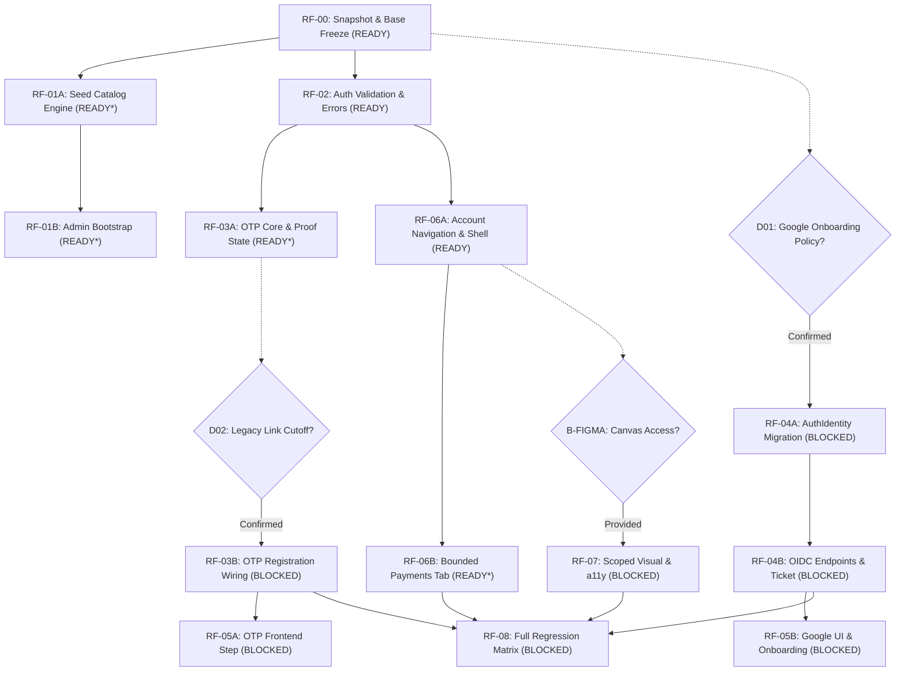

# Final Technical Review 2: BookingManagement Refactor Plan V2.0

**Reviewer:** Antigravity Independent Technical Reviewer (`agency-code-reviewer`)  
**Target Document:** [`docs/refactor/REFACTOR_PLAN_V2_FINAL.md`](file:///C:/Users/Admin/Documents/booking-payments/docs/refactor/REFACTOR_PLAN_V2_FINAL.md)  
**Input Baseline:**  
- [`docs/refactor/REFACTOR_PLAN_V1.md`](file:///C:/Users/Admin/Documents/booking-payments/docs/refactor/REFACTOR_PLAN_V1.md)  
- [`docs/refactor/REFACTOR_REVIEW_1.md`](file:///C:/Users/Admin/Documents/booking-payments/docs/refactor/REFACTOR_REVIEW_1.md)  
- Relevant schema, migrations, controllers, and tests in workspace `C:/Users/Admin/Documents/booking-payments` (branch `feat/payments`, target `booking-payments`)  
**Date:** 2026-10-20  
**Workflow Stage:** Plan V1 → Review 1 → Plan V2.0 → **Review 2 (Final)** → Implementation  

---

## 1. Final Verdict

### **VERDICT: READY_WITH_DOCUMENTED_BLOCKERS**

> [!IMPORTANT]
> **Summary Judgment:**  
> Plan V2.0 (`REFACTOR_PLAN_V2_FINAL.md`) has achieved high architectural maturity. Every finding from Review 1 (`F-01` through `F-08`) and all corrective requirements (`CR-01` through `CR-07`) have been thoroughly addressed, substantiated with code-level evidence, and integrated into explicit contracts.
>
> 1. **Zero Unaddressed Flaws:** No architectural blindspots, unvetted framework additions, or regressions on existing payment work remain in the plan.
> 2. **Independent Packages are Fully Unblocked:** Core packages—including snapshot/branch isolation (`RF-00`), seed baseline & Admin bootstrap (`RF-01A`, `RF-01B`), login validation decoupling & safety byte caps (`RF-02`), OTP service primitives (`RF-03A`), account navigation & clean profile/security views (`RF-06A`), and bounded on-demand payment history (`RF-06B`)—are **100% ready for execution**.
> 3. **Blockers are Rigorously Isolated & Documented:** Features with unresolved business policies (`D01` Google onboarding, `D02` legacy verification link cutoff) or missing external infrastructure (`B-FIGMA`, `B-TEST`, `B-GOOGLE`, `B-SMTP`) are strictly gated as `BLOCKED`. The plan explicitly forbids fabricating fake data or bypassing security gates to force completion.
>
> **The planning cycle is officially closed. No Plan V3 or Review 3 will take place.** Implementation may proceed immediately on all unblocked packages upon explicit user instruction.

---

## 2. Review 1 Closure Status

All 8 findings identified in Review 1 have been audited against Plan V2.0 and the repository reality:

| Finding ID | Severity | Review 1 Core Concern | Plan V2.0 Resolution Details | Closure Status |
| :--- | :--- | :--- | :--- | :--- |
| **`F-01`** | **HIGH** | Undefined state machine, temporary token mechanics, and collision retries during Google first-time onboarding. | **§3.4, §5 RF-04B/RF-05B, T23b/T23c:** Implemented an ephemeral, signed/encrypted Redis ticket (`google_onboarding_token`, 900s TTL, HttpOnly, host-only, SameSite policy). Explicit DTO and contract for `POST /api/auth/oauth/google/onboard`. Onboarding conflicts (`409 ONBOARDING_FIELD_CONFLICT`) preserve ticket and allow in-place correction without re-triggering OAuth. Provisioning gated behind policy decision `D01`. | **CLOSED** |
| **`F-02`** | **HIGH** | Proposed `/account/payments` caused client-side $N+1$ HTTP request storm due to lack of a customer payments feed. | **§3.6, §5 RF-06B, T29b/T30b:** Maintained 5-item avatar menu. `/account/payments` redirects to `/bookings?tab=payments`. Enforced strict bounded reads: initial tab load triggers **0 payment requests**; expanding a booking triggers at most **3 reads** (E6 PREPAYMENT, E6 BALANCE, E11 refunds); max 2 concurrent requests; single-flight per key; no auto-polling; clear independent error states. Transparent copy: *"Hệ thống chưa hỗ trợ hóa đơn điện tử."* | **CLOSED** |
| **`F-03`** | **HIGH** | Database migration timestamp inversion hazard with future-dated payment migrations (`20261021` and `20261022`). | **§3.5, §5 RF-04A, T38/T38b:** Fixed the auth migration sequence to **`20261023000000_auth_identity_oauth`**, strictly following `20261022000000_payments_audit_log`. Required testing full migration chain from scratch on clean database (`T38b`) and upgrading existing data (`T38`) with 5s lock timeout. | **CLOSED** |
| **`F-04`** | **MEDIUM** | Redis consumes OTP code atomically, but if PostgreSQL commit fails, the code is burned and user is locked out by rate limits. | **§3.3, §5 RF-03A/B, T18/T18b:** Introduced a two-stage verification state: when code is validated, Lua script marks state as `VERIFIED_PENDING_ACTIVATION` with a 120s deadline. If DB commit fails, backend returns `503 OTP_ACTIVATION_PENDING` with `Retry-After: 2`. User can retry activation via `POST /api/auth/email-otp/activate` without entering a new OTP code or consuming hourly email quota. | **CLOSED** |
| **`F-05`** | **MEDIUM** | Re-creating a deleted court in `seed.mjs` crashes with unhandled Postgres 23505 error if court code is held by an unmanaged UUID. | **§3.1, §5 RF-01A, T05/T05b:** Added mode-wide preflight checks in `seed.mjs` verifying `(branch_id, code)` before insert. If an unmanaged UUID occupies the natural key, the script exits cleanly with exit code 1 (`SEED_NATURAL_KEY_CONFLICT`), logs an actionable diagnostic, and performs zero writes. | **CLOSED** |
| **`F-06`** | **MEDIUM** | Login password safety byte cap ($4096$ bytes) was unnecessarily large, posing an Argon2 CPU saturation vector. | **§3.2, §5 RF-02, T09b:** Calibrated `LOGIN_PASSWORD_MAX_BYTES` to `1024` UTF-8 bytes (providing ample headroom for 128 Unicode codepoints while bounding payload size). Added early rejection (400 `INVALID_LOGIN_INPUT`) before invoking Hasher or querying account store. | **CLOSED** |
| **`F-07`** | **LOW** | Obsolete hardcoded text on `/bookings` (*"chưa có thanh toán"*). | **§3.6, §5 RF-06A, T28:** Replaced with neutral server-status copy: *"Trạng thái đặt sân được cập nhật tự động từ máy chủ."* Asserted old text absence in `frontend-booking-rendering.spec.tsx`. | **CLOSED** |
| **`F-08`** | **LOW** | Empty `UserController`; risk of rendering dead-end mock CTAs on Profile and Security screens. | **§3.6, §5 RF-06A, T27:** Mandated read-only presentation for `/account` and `/account/security`. Non-functional CTAs (edit profile, 2FA, delete account) are omitted entirely or presented as plain informational text. | **CLOSED** |

---

## 3. Implementation Readiness

### 3.1 Work Packages & Execution Boundaries

Plan V2.0 decomposes the work into 14 explicit, sequential, single-writer work packages:


*(READY\* indicates ready for implementation, with external test infrastructure required for final exit verification).*

### 3.2 Evaluation Across Architectural Dimensions

1. **Database & Migrations:**  
   - Sequence is strictly pinned (`20261023000000_auth_identity_oauth`).
   - `User.passwordHash` nullable migration preserves all existing records without rewriting hashes.
   - Foreign key constraint on `auth_identities` (`onDelete: Restrict`) prevents orphaned identity rows.
   - Seed engine operates under preflight validation with zero data destruction.
2. **Authentication Security:**  
   - Legacy passwords (<12 chars) are protected on login; registration policy (12–128 chars, complexity) remains untouched.
   - Timing attacks mitigated via dummy password hashing for nonexistent users.
   - Google account linking is strictly prohibited on matching emails; safe collision resolution is enforced.
   - Onboarding state is secured via signed/opaque Redis ticket; direct user enumeration is prevented.
3. **Frontend & Navigation:**  
   - 5 native disclosure menu items: Profile, Security, Booking History, Invoices & Payments, Logout.
   - Standalone `/account/payments` route redirects to `/bookings?tab=payments`.
   - Bounded on-demand payment reading prevents client-side request storms.
   - All mock or non-functional buttons are eliminated.
4. **Payment Preservation & Regression:**  
   - Existing uncommitted payment migrations and source files in `feat/payments` are preserved in-place.
   - Payment models and business rules (MIG-01 through MIG-20) remain frozen and untouched.
   - Tests with `describe.skip` are tracked and gated to prevent false green test runs.

---

## 4. Residual Findings (Implementation Checklist)

The following two low-severity implementation observations must be observed during coding by the implementer:

| ID | Severity | Evidence | Minimal Required Fix | Implementation Package |
| :--- | :--- | :--- | :--- | :--- |
| **`RES-01`** | **LOW** | [`backend/src/main.ts` lines 17–25](file:///C:/Users/Admin/Documents/booking-payments/backend/src/main.ts#L17-L25) | When configuring the route-specific 64KiB body limit on `/api/auth/*`, ensure it is applied as route-level middleware so it does not interfere with the raw body parser required for payOS webhook HMAC signature validation on `/api/payments/payos/webhook`. | `RF-02` |
| **`RES-02`** | **LOW** | [`frontend/app/account/payments/page.tsx`](file:///C:/Users/Admin/Documents/booking-payments/docs/refactor/REFACTOR_PLAN_V2_FINAL.md#L221) | Ensure the server-side redirect from `/account/payments` to `/bookings?tab=payments` uses standard Next.js `redirect('/bookings?tab=payments')` inside `page.tsx` to prevent client-side routing flash or hydration mismatches. | `RF-06B` |

---

## 5. Hard Blockers

The following items are explicit hard blockers. Implementation of these specific packages **must not proceed** until the blocking conditions are resolved:

```text
+----------------------------------------------------------------------------------------------------+
|                                      DOCUMENTED HARD BLOCKERS                                      |
+---------+----------------------------------+-------------------------+-----------------------------+
| ID      | Unresolved Dependency            | Blocked Packages        | Unblocking Condition        |
+---------+----------------------------------+-------------------------+-----------------------------+
| D01     | User confirmation on Google      | RF-04A, RF-04B, RF-05B  | Explicit user approval of   |
|         | onboarding policy (collect real  |                         | onboarding flow and         |
|         | phone & username; CUSTOMER only; |                         | nullable passwordHash.      |
|         | nullable passwordHash; no link). |                         |                             |
+---------+----------------------------------+-------------------------+-----------------------------+
| D02     | User approval to invalidate      | RF-03B, RF-05A          | Explicit user approval to   |
|         | legacy email verification links  |                         | retire link-based verify in |
|         | lacking `issuedAt` metadata.     |                         | favor of OTP.               |
+---------+----------------------------------+-------------------------+-----------------------------+
| B-FIGMA | Figma canvas/frame access.       | RF-07 (Fidelity signoff)| Provision of frame exports  |
|         |                                  |                         | or readable Figma access.   |
+---------+----------------------------------+-------------------------+-----------------------------+
| B-TEST  | Dedicated disposable PG/Redis.   | Integration exit gates  | Confirmation of isolated    |
|         |                                  | in 01, 03, 04, 06B, 08  | test database environment.  |
+---------+----------------------------------+-------------------------+-----------------------------+
```

> [!NOTE]
> **Decoupled Progression:** The existence of `D01` and `D02` does **NOT** block the execution of `RF-00`, `RF-01A`, `RF-01B`, `RF-02`, `RF-03A`, `RF-06A`, and `RF-06B`. The implementer can immediately build and verify these core foundations.

---

## 6. Verification Requirements

For each package completed, the following verification gates must be satisfied:

1. **Pre-Implementation Checkpoint (`T35`):**  
   Record exact `git status`, HEAD commit SHA, and SHA-256 digests of all uncommitted files. Ensure zero loss of payment WIP.
2. **Deterministic Seed & Preflight Test (`T01`–`T07`, `T05b`):**  
   Verify double-seed idempotency, deletion re-creation, and verify that `PRO-01` natural key collision triggers clean exit 1 with zero database mutation.
3. **Login Password UTF-8 Byte Limit Boundary (`T09b`):**  
   Assert that a 1024-byte password passes validation to Hasher, and a 1025-byte password is rejected with `400 Bad Request` prior to Hasher invocation.
4. **Bounded On-Demand Payment History (`T29b`, `T30b`):**  
   Assert that loading `/bookings?tab=payments` with 50 bookings fires **0 payment HTTP calls**, and expanding a single card fires at most 3 requests with independent error boundaries.
5. **Full Migration Chain (`T38`, `T38b`):**  
   Execute `prisma migrate deploy` from scratch on a clean PostgreSQL instance with migrations through `20261023000000_auth_identity_oauth`. Assert exit 0 and verify all SQL constraints active.

---

## 7. Final Implementation Handoff

- **Target Branch:** Create/checkout `booking-payments` in-place from current HEAD (`feat/payments`), preserving all dirty and untracked payment files without stashing or resetting.
- **Implementation Sequence:**
  1. **Phase 1 (Unblocked Core):** `RF-00` → `RF-01A` → `RF-01B` → `RF-02` → `RF-03A` → `RF-06A` → `RF-06B`.
  2. **Phase 2 (Policy-Gated):** Upon confirmation of `D02` → implement `RF-03B` and `RF-05A`.
  3. **Phase 3 (OAuth-Gated):** Upon confirmation of `D01` → implement `RF-04A`, `RF-04B`, and `RF-05B`.
  4. **Phase 4 (Final Regression):** Execute `RF-08` test matrix and CI verification.

---

## 8. Role and Work Verification Report

Per workspace policy (`ai/rules/AGENCY-ROUTING.md`):

| Role | Agency Skill Path | Responsibilities in Task | Actual Work Performed & Evidence |
| :--- | :--- | :--- | :--- |
| **Independent Technical Reviewer** (Primary) | [`.agents/skills/agency-code-reviewer/SKILL.md`](file:///C:/Users/Admin/Documents/booking-payments/.agents/skills/agency-code-reviewer/SKILL.md) | Conduct final technical review of `REFACTOR_PLAN_V2_FINAL.md` against Review 1 findings and codebase reality. | Audited Plan V2 resolution matrix against findings `F-01`–`F-08`; verified closure of all High/Medium issues; formulated residual checklist and issued final implementation handoff. |
| **Backend & Database Specialist** (Supporting) | [`.agents/skills/agency-backend-architect/SKILL.md`](file:///C:/Users/Admin/Documents/booking-payments/.agents/skills/agency-backend-architect/SKILL.md) & [`.agents/skills/agency-database-optimizer/SKILL.md`](file:///C:/Users/Admin/Documents/booking-payments/.agents/skills/agency-database-optimizer/SKILL.md) | Audit migration sequence, seed conflict preflight, and bounded payment read patterns. | Verified migration timestamp order (`20261023`), seed preflight natural key handling, and the elimination of client-side $N+1$ fan-out on payments. |
| **AppSec Specialist** (Supporting) | [`agency-application-security-engineer`](file:///C:/Users/Admin/.gemini/config/skills/agency-application-security-engineer/SKILL.md) | Audit OAuth onboarding state machine, OTP proof recovery, and login DoS bounds. | Confirmed security of the ephemeral Redis onboarding ticket (`F-01`), the 120s proof activation state (`F-04`), and the 1024-byte login boundary (`F-06`). |

- **Execution Environment:** Antigravity CLI / Gemini 3.8 Flash (Medium).
- **Execution Mode:** 100% Read-Only Review. No source code, database, migration, or plan file was altered.
- **Artifacts Generated:**  
  - Primary report: [`docs/refactor/REFACTOR_REVIEW_2_FINAL.md`](file:///C:/Users/Admin/Documents/booking-payments/docs/refactor/REFACTOR_REVIEW_2_FINAL.md)
  - Coordination mirror: [`coordination/reports/REFACTOR_REVIEW_2_FINAL.md`](file:///C:/Users/Admin/Documents/booking-payments/coordination/reports/REFACTOR_REVIEW_2_FINAL.md)

---

FINAL REVIEW 2 COMPLETE — PLANNING PROCESS CLOSED  
NEXT OWNER: MUSE SPARK — IMPLEMENTATION
